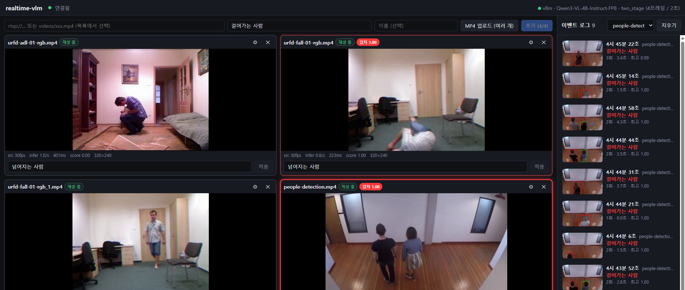
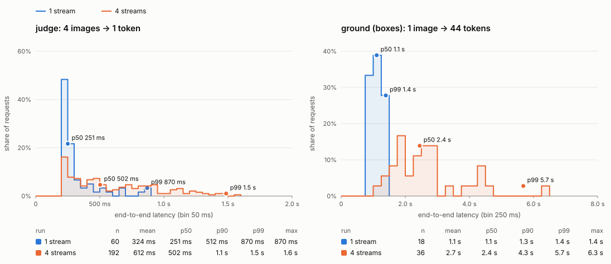
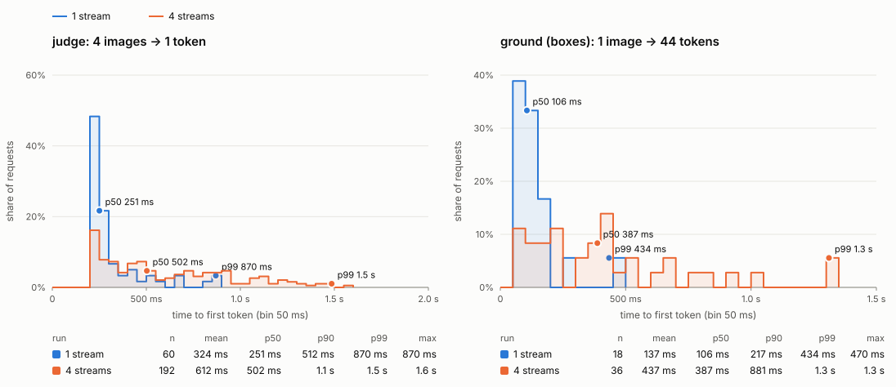

# realtime-vlm

[English](README.md) | **한국어**



RTSP 카메라와 MP4 영상을 최대 4개까지 동시에 받아서, **자유 텍스트 프롬프트**(예: `넘어지는 사람`, `걸어가는 사람`)에 해당하는 대상을 VLM(Vision-Language Model)으로 찾고 **위치(bbox)를 실시간으로** 보여주는 시스템입니다. 감지된 장면은 스냅샷과 함께 이벤트 로그로 남습니다.

- **입력**: RTSP / MP4 (웹 업로드 또는 `videos/` 폴더), 최대 4개 동시
- **모델**: Qwen3-VL-4B-Instruct-FP8 (vLLM 서빙, RTX 4060 8GB에서 동작)
- **출력**: 프롬프트에 해당하는 대상의 bbox, 감지 점수, 이벤트 로그(스냅샷)
- **UI**: 웹 페이지 (2x2 그리드 + 이벤트 패널)

---

## 목차
1. [구조](#구조)
2. [요구 사항](#요구-사항)
3. [빠른 시작](#빠른-시작)
4. [UI 사용법](#ui-사용법)
5. [추론 방식](#추론-방식)
6. [설정](#설정-configsconfigyaml)
7. [개발](#개발)
8. [API](#api)
9. [성능과 제약](#성능과-제약)
10. [프로파일링](#프로파일링)
11. [폴더 구조](#폴더-구조)
12. [샘플 영상 출처](#샘플-영상-출처)

---

## 구조

```
 브라우저 ── http://127.0.0.1:8000 ──▶ frontend (Vite, React)
                                         │  /api, /ws, /event-files 프록시
                                         ▼
                                       backend (FastAPI)            ◀── RTSP 카메라 / MP4
                                         │  스트림 디코딩 · 프레임 샘플링 · 이벤트 저장
                                         │  HTTP (OpenAI 호환 API)
                                         ▼
                                       serving (vLLM, GPU)
                                         Qwen3-VL-4B-Instruct-FP8
```

| 컨테이너 | 역할 | 이미지 | 포트 (127.0.0.1) |
|---|---|---|---|
| `realtime-vlm-serving` | VLM 서빙 (GPU) | vllm/vllm-openai v0.33.0 | 9000 |
| `realtime-vlm-backend` | 스트림 입력, 추론 요청, 이벤트, REST/WS/MJPEG | python:3.12-slim + ffmpeg | 8001 (`/docs`) |
| `realtime-vlm-frontend` | 웹 UI (Vite 개발 서버) | node:22-slim | **8000** |

- **소스 코드는 이미지에 넣지 않고 볼륨으로 마운트합니다.** 코드를 고쳐도 다시 빌드할 필요가 없습니다(backend는 자동 재시작, frontend는 HMR).
- backend는 serving이 준비(healthy)된 뒤에 시작합니다.
- serving 백엔드는 `vllm`과 `triton`(예정) 중에서 고를 수 있습니다(`configs/config.yaml`의 `serving.backend`).

## 요구 사항

- NVIDIA GPU 8GB 이상 (RTX 4060 8GB에서 확인)
- Docker + Docker Compose v2 + NVIDIA Container Toolkit
- WSL2를 쓰면 `.wslconfig`에 `memory=12GB` 이상을 권장합니다(모델 로딩 시 메모리 부족 방지).

## 빠른 시작

### 1. 모델 준비 (`model_files/`)
모델은 로컬 폴더에서 읽고, 실행 중에는 인터넷에 접속하지 않습니다(`serving.offline: true`). 처음 한 번만 받아 두면 됩니다.

```bash
sh build_docker.sh   # 다운로드에 serving 이미지를 쓰므로 먼저 빌드

# 기본 모델 (약 5.7GB)
docker run --rm --entrypoint python3 -u $(id -u):$(id -g) -e HF_HOME=/tmp/hf \
  -v $(pwd)/model_files:/workspace/model_files realtime-vlm-serving:latest -c \
  "from huggingface_hub import snapshot_download; snapshot_download('Qwen/Qwen3-VL-4B-Instruct-FP8', local_dir='/workspace/model_files/Qwen3-VL-4B-Instruct-FP8')"

# (선택) 가벼운 대안 모델 Qwen3-VL-2B-Instruct (약 4GB): 위 명령에서 모델 이름만 바꿉니다.
```

### 2. 빌드 및 실행
```bash
sh build_docker.sh   # docker compose build (의존성이 바뀔 때만)
sh run_docker.sh     # docker compose up -d
```
첫 실행 시 vLLM이 모델을 올리고 컴파일하는 데 1~2분 걸립니다. 진행 상황은 `docker compose logs -f serving`으로 볼 수 있습니다.

### 3. 접속
- UI: **http://127.0.0.1:8000**
- API 문서: http://127.0.0.1:8001/docs

### 4. 종료
```bash
docker compose down
```

## UI 사용법

| 기능 | 방법 |
|---|---|
| 스트림 추가 | 상단 입력칸에 `rtsp://...` 또는 `videos/...mp4`를 입력(클릭하면 파일 목록이 뜸)하고, 프롬프트를 쓴 뒤 **추가** |
| 여러 개 한 번에 추가 | **MP4 업로드 (여러 개)** 에서 파일을 여러 개 선택하면, 빈 슬롯 수만큼 바로 스트림으로 추가됩니다. 남는 파일은 업로드만 됩니다 |
| 빈 슬롯에서 추가 | **＋ 빈 슬롯** 을 클릭하면 그 자리에 추가 폼이 뜹니다 |
| 프롬프트 변경 | 타일 아래 입력칸에서 바꾸고 **적용** (실행 중에 바로 반영) |
| 세부 설정 | 타일의 ⚙ 버튼: 프레임 수, 구간(초), 요청 간격(ms), 판단 임계값 |
| 감지 표시 | 빨간 테두리 + `감지 0.xx` 배지, 영상 위에 bbox와 라벨 |
| 이벤트 로그 | 우측 패널. 스트림별 필터, 지우기, 클릭하면 스냅샷 상세 |
| 스트림 삭제 | 타일의 ✕ |

- 마지막으로 쓴 프롬프트는 브라우저에 저장되어 다음에 기본값으로 들어갑니다.
- 업로드한 파일은 `videos/uploads/`에 저장됩니다. 같은 이름이면 `name_1.mp4`처럼 번호가 붙습니다.

### 테스트용 RTSP 카메라
`videos/` 안의 mp4를 RTSP 카메라처럼 송출합니다(compose 네트워크 안에서 동작).
```bash
sh tools/rtsp_sim.sh videos/samples/urfd-fall-01-rgb.mp4 cam1   # UI에 rtsp://rtsp-sim:8554/cam1 입력
sh tools/rtsp_sim.sh videos/samples/people-detection.mp4 cam2
sh tools/rtsp_sim.sh stop
```
실제 카메라 주소 형식의 예:
- Hikvision: `rtsp://user:pw@IP:554/Streaming/Channels/101`
- Dahua: `rtsp://user:pw@IP:554/cam/realmonitor?channel=1&subtype=0`

## 추론 방식

기본값은 **two_stage**입니다(`inference.strategy`).

1. **판단 (judge)**: 최근 2초에서 고른 프레임 4장을 시간 순서대로 보내 "프롬프트에 해당하는가"를 yes/no로 묻습니다. yes의 확률(logprob)이 **점수**가 됩니다.
2. **위치 (grounding)**: 점수가 `judge_threshold`(0.5) 이상이면, 마지막 프레임 1장으로 bbox를 받습니다.

- 판단 결과는 bbox보다 먼저 WebSocket으로 보냅니다. 그래서 프레임 후 약 0.2초 만에 경고가 뜨고, bbox는 약 1초 뒤에 따라옵니다.
- 같은 스트림에서 5초 안에 다시 감지되면 하나의 이벤트로 합칩니다(`events.cooldown_sec`).

### 평가 결과 (UR Fall 샘플 4개, 0.25초 간격, `넘어지는 사람`)

| 모델 | 방식 | 정밀도 | 재현율 | F1 | 오탐 | bbox IoU |
|---|---|---|---|---|---|---|
| 2B | multi_image (4장 → bbox 한 번에) | 0.28 | 0.31 | 0.29 | 21 | 0.12 |
| 2B | two_stage, 4장 | 0.60 | 0.96 | 0.74 | 17 | 0.98 |
| 4B-FP8 | two_stage, 1장 | 0.92 | 0.85 | 0.88 | 2 | 0.98 |
| **4B-FP8** | **two_stage, 4장 (기본값)** | **1.00** | **0.85** | **0.92** | **0** | **0.99** |

- 4장을 한 번에 보내고 bbox를 받으면 좌표가 깨집니다. 그래서 4장은 판단에만 쓰고, bbox는 1장으로 받습니다.
- 놓친 경우는 모두 넘어지기 시작하는 첫 0.25~0.5초입니다. 감지가 그만큼 늦다고 보면 됩니다.
- 표본이 영상 4개뿐이라 실제 CCTV 영상으로 다시 검증해야 합니다.
- 다시 실행하려면: `docker exec -w /workspace realtime-vlm-backend python3 backend/examples/eval_strategies.py`

## 설정 (`configs/config.yaml`)

serving과 backend가 함께 쓰는 설정 파일입니다. backend 쪽 값은 저장하면 자동으로 반영되고, serving 쪽 값은 `docker compose restart serving`이 필요합니다.

| 섹션 | 키 | 기본값 | 설명 |
|---|---|---|---|
| serving | `backend` | `vllm` | `vllm` \| `triton`(예정) |
| | `model_id` | `model_files/Qwen3-VL-4B-Instruct-FP8` | 로컬 모델 폴더 |
| | `gpu_memory_utilization` | `0.85` | 4B 기준. 2B는 0.78 |
| | `max_model_len` | `2048` | 4B 기준. 2B는 8192 |
| | `scheduling_policy` | `priority` | bbox 요청을 판단 요청보다 먼저 처리 |
| | `extra_args` / `extra_env` | `""` / `{}` | `vllm serve`에 추가할 인자 / 환경변수 (예: 프로파일링, 아래 참고) |
| preprocess | `max_side` | `448` | 서버로 보내는 프레임의 긴 변(px). 서버 쪽 메모리 계산과 이미지 크기 상한에도 같이 쓰임 |
| inference | `strategy` | `two_stage` | `two_stage` \| `multi_image` \| `single_frame` |
| | `judge_threshold` | `0.5` | 판단 점수 임계값 |
| | `num_frames` / `window_sec` | `4` / `2.0` | 판단에 쓰는 프레임 수 / 구간 |
| stream | `max_streams` | `4` | 동시 스트림 수 |
| | `interval_ms` | `1000` | 스트림별 요청 간격 (아래 성능 참고) |
| | `buffer_fps` / `buffer_max_side` | `10` / `960` | 링버퍼 저장 속도 / 해상도 (스냅샷 해상도) |
| events | `cooldown_sec` | `5.0` | 이 시간 안의 재감지는 같은 이벤트로 합침 |
| backend | `reload` | `true` | 코드 수정 시 자동 재시작 |
| profiling | `enabled` | `false` | `/api/profile` 구간 계측 (실행 중에도 켜고 끌 수 있음) |

환경 변수 `SERVING`, `MODEL_ID`로 serving 값을 덮어쓸 수 있습니다(예: `MODEL_ID=model_files/Qwen3-VL-2B-Instruct sh run_docker.sh`). 이때 메모리 관련 값(`gpu_memory_utilization`, `max_model_len`)은 config에서 같이 바꿔야 합니다.

## 개발

| 바꾼 것 | 해야 할 일 |
|---|---|
| `backend/app/**`, `configs/` | 없음 (uvicorn 자동 재시작) |
| `frontend/src/**` | 없음 (HMR, 브라우저에 바로 반영) |
| `serving/*.sh`, config의 serving 값 | `docker compose restart serving` |
| `backend/requirements.txt`, `frontend/package.json`, vLLM 버전 | `sh build_docker.sh && sh run_docker.sh` |

```bash
docker compose ps                         # 상태
docker compose logs -f backend            # 로그 (serving, frontend도 동일)
docker exec -it realtime-vlm-backend bash # 컨테이너 접속 (vim, net-tools, alias 포함)

# 서버에 직접 추론 (이미지 / 영상 / 영상 전체 훑기)
sh backend/examples/run_vlm_inference.sh --video videos/samples/urfd-fall-01-rgb.mp4 --at 4 --prompt "넘어지는 사람"
sh backend/examples/run_vlm_inference.sh --video videos/samples/urfd-fall-01-rgb.mp4 --sweep 0.5 --prompt "넘어지는 사람"
#   → 결과 이미지: data/inference/

# WebSocket 결과 통계 (스트림별 감지율, 지연)
docker exec realtime-vlm-backend python3 examples/ws_monitor.py --sec 20

# frontend 타입 체크
docker exec realtime-vlm-frontend npx tsc --noEmit
```

- 스트림 목록은 메모리에만 있습니다. backend가 재시작(코드 수정 포함)되면 스트림은 사라지고, 이벤트는 `data/events/`에 남습니다.
- **브라우저가 MJPEG 프리뷰를 열어 둔 상태에서는 자동 재시작이 멈출 수 있습니다** (uvicorn이 열린 연결이 닫히기를 기다림: 로그가 `Waiting for connections to close`에서 멈춤). `docker restart realtime-vlm-backend`로 재시작합니다.
- backend와 frontend는 호스트 사용자 UID로 실행되므로 `data/`, `videos/uploads/` 파일은 사용자 소유로 생깁니다.

## API

backend: `http://127.0.0.1:8001` (UI에서는 `http://127.0.0.1:8000/api/...`로도 접근 가능)

| Method | Path | 설명 |
|---|---|---|
| GET | `/api/health` | 서빙 상태, 모델, 추론 설정 |
| GET / POST | `/api/streams` | 목록 / 추가 `{url, prompt, name?, num_frames?, window_sec?, interval_ms?, judge_threshold?}` |
| GET / PATCH / DELETE | `/api/streams/{id}` | 조회 / 설정 변경 / 삭제 |
| GET | `/api/streams/{id}/mjpeg` | 라이브 영상 (`?overlay=1`: 서버가 박스를 그림) |
| GET | `/api/streams/{id}/snapshot` | 최신 프레임 JPEG |
| GET | `/api/videos` | `videos/` 안의 영상 목록 |
| POST | `/api/upload` | 영상 업로드 (multipart `file`) |
| GET / DELETE | `/api/events` | 이벤트 목록 (`?stream_id=&limit=`) / 전체 삭제 |
| GET | `/event-files/{YYYYMMDD}/{id}.jpg` | 이벤트 스냅샷 |
| GET / POST | `/api/profile` | 구간 계측 + 스레드별 CPU / `?enabled=true&reset=true` 켜기/끄기, 초기화 ([프로파일링](#프로파일링) 참고) |
| WS | `/ws` | `status`(1초마다), `judge`, `result`, `event`, `error` 메시지 |

## 성능과 제약

RTX 4060 8GB + Qwen3-VL-4B-FP8 기준, 4스트림 동시(RTSP 1 + MP4 3):

| 스트림별 요청 간격 | 판단만 | 감지 시 판단+bbox (p90) |
|---|---|---|
| 250ms | 약 300ms | 약 4초 |
| 500ms | 약 300ms | 2.5~4초 |
| **1000ms (기본값)** | 200~300ms | **약 1.7초** |

- **bbox 생성(약 44토큰)이 느린 게 병목입니다.** 디코딩 각 단계가 다른 스트림의 판단 요청과 같이 처리되기 때문입니다. 1스트림만 돌릴 때는 약 1초 걸립니다.
- **GPU 메모리가 빠듯합니다.** 8GB 중 약 7.2GB를 쓰고 KV cache는 약 3,200토큰입니다. Windows 쪽에서 GPU를 많이 쓰면 serving 기동이 실패할 수 있습니다.
- **화면의 bbox는 추론한 프레임 기준이라**, 움직이는 대상에서는 약 1초 뒤처져 보입니다. 이벤트 스냅샷은 그 프레임에 직접 그리므로 정확합니다.
- **스냅샷 폴더 날짜는 컨테이너 시간대(UTC) 기준입니다.** UI의 시각은 브라우저 시간으로 표시됩니다.

## 프로파일링

비용이 싼 것부터 세 가지 도구가 있습니다.

| 질문 | 도구 |
|---|---|
| 설정 A가 B보다 빠른가? 이 부하에서 지연 백분위수는? | [`vllm bench serve`](#vllm-벤치마크-vllm-bench-serve) (`bench_vllm.sh`): vLLM만 단독으로, 실행당 명령 하나 |
| 서비스 전체(backend, 네트워크, vLLM)의 시간이 어디에 쓰이는가? | [전체 시스템 프로파일링](#전체-시스템-프로파일링-방법) (`metrics_scenario.sh`) |
| vLLM이 왜 느린가 (GPU 타임라인, 엔진 루프)? | [vLLM 내부](#vllm-내부): py-spy, torch profiler. 벤치마크 결과가 이상할 때만 사용 |

### 전체 시스템 프로파일링 방법

처음에는 "VLM이 가장 느리다"고 가정했습니다. 이 가정에 기대지 않고 파이프라인 전체(디코딩 → 링버퍼 → 샘플링 → 전처리 → HTTP → vLLM → publish → WebSocket / MJPEG)를 세 단계로 측정했습니다.
라인 프로파일러(`line_profiler`, `cProfile`)는 쓰지 않았습니다. 줄마다 훅이 걸려서 초당 30번 도는 디코드 루프가 느려지고, 그 때문에 측정 결과 자체가 달라집니다. 또 어느 함수에 데코레이터를 붙일지 미리 정해야 하므로 결국 같은 가정을 반복하게 됩니다. `cProfile`은 메인 스레드만 봅니다. 그리고 두 도구 모두 CPU 시간과 *대기 시간*을 구분하지 못합니다. 추론 스레드는 대부분의 시간을 HTTP 응답을 기다리며 보냅니다.

1. **`perf_counter`로 구간 계측 (`backend/app/profiling.py`)**: 추론 한 사이클의 지연이 어디에 쓰이는지 봅니다.
   - 각 구간을 `prof.span("stage")` / `prof.add(...)`로 감쌉니다. `GET /api/profile`이 구간별 횟수, 초당 횟수, 평균, p50/p90/p99/max, `busy`(벽시계 1초당 그 구간에 쓴 초)를 돌려줍니다.
   - 그 밖에 기록하는 것:
     - **frame age**: 사이클 시작 / judge 발행 / 결과 발행 시점에 최신 프레임이 얼마나 오래됐는지
     - **asyncio 이벤트 루프 지연**
     - **스레드별 CPU**: `/proc/self/task/<native_id>/stat`을 Python 스레드 이름에 매핑합니다(`src:*` 디코딩, `infer:*` 추론, `MainThread` asyncio). 프로세스 전체에서 이를 뺀 나머지는 native 스레드(ffmpeg, OpenCV)입니다.
   - 클라이언트에서 잰 HTTP 시간을 vLLM 자체의 `e2e` 지표와 비교하면 네트워크 + API 서버 비용이 나옵니다.
   - 기본은 꺼져 있고(`profiling.enabled`), `POST /api/profile?enabled=true`로 실행 중에 켜면서 초기화합니다. 꺼져 있을 때 구간 하나의 비용은 속성 확인 한 번입니다.
2. **샘플링 프로파일러 py-spy**: 어떤 코드가 CPU를 쓰는지 봅니다. C 코드(OpenCV, ffmpeg)와 GIL까지 포함합니다.
   - 코드 수정 없이 실행 중인 프로세스에 붙고, 모든 스레드를 보며, 오버헤드가 거의 없습니다.
   - 같은 구간에 두 가지를 동시에 기록합니다.
     - native 프레임을 포함한 전체 스레드 (`--threads --native`, speedscope 형식)
     - GIL을 쥔 스레드만 (`--gil`, GIL 경합 확인)
   - 컨테이너에 `SYS_PTRACE`가 없어서 `docker exec --privileged -u root`로 실행합니다. 컨테이너를 다시 만들 필요가 없고, py-spy는 처음 실행할 때 설치됩니다.
   - uvicorn `--reload` 모드에서 앱은 PID 1이 아니라 리로더의 자식 프로세스입니다(`spawn_main`, 부모 PID 1).
3. **재현 가능한 부하를 걸고 한 번에 수집 (`metrics_scenario.sh` → `profile_report.py`)**.
   - 스크립트가 모든 스트림을 샘플 영상 N개로 교체하고, 필요하면 UI처럼 MJPEG 프리뷰를 열고, 워밍업합니다.
   - 같은 구간에 vLLM `/metrics`(`vllm_metrics.py`, GPU 사용률 포함), WebSocket 통계(`ws_monitor.py`), `/api/profile`, py-spy 기록 두 가지를 수집합니다.
   - `profile_report.py`가 이를 하나의 리포트로 합칩니다.
     - 구간 표
     - 사이클 분해
     - 클라이언트 HTTP와 vLLM 엔진 시간 비교
     - 스레드별 CPU
     - 스레드 그룹별 py-spy 상위 프레임
     - GIL 보유자

```bash
# 1. 구간 계측 직접 보기 (스트림이 돌고 있는 상태)
curl -X POST 'http://127.0.0.1:8001/api/profile?enabled=true'    # 켜기 + 초기화
curl -s http://127.0.0.1:8001/api/profile | python3 -m json.tool  # 잠시 후 조회

# 2. py-spy 직접 쓰기 (앱 = uvicorn 리로더의 자식 프로세스)
docker exec -u root realtime-vlm-backend pip install py-spy
docker exec --privileged -u root realtime-vlm-backend py-spy dump --pid <앱 pid>
docker exec --privileged -u root realtime-vlm-backend py-spy top  --pid <앱 pid>

# 3. 시나리오: 현재 스트림을 모두 지우고, 샘플 영상 N개를 같은 프롬프트로 추가, 10초 워밍업 후 위 항목을 모두 수집
#   metrics_scenario.sh <label> <스트림 수> <프롬프트> [interval_ms] [sec]
sh backend/examples/metrics_scenario.sh 4s-judgeonly 4 "불타는 자동차" 1000 60   # 해당 없음: 판단만
sh backend/examples/metrics_scenario.sh 4s-person    4 "사람"         1000 60   # 항상 해당: 매번 판단 + bbox
sh backend/examples/metrics_scenario.sh 4s-fall      4 "넘어지는 사람" 1000 60   # 실제 사용
MJPEG=1 VIDEO_DIR=videos/samples-1080p PYSPY=0 \
  sh backend/examples/metrics_scenario.sh p4-1080p 4 "넘어지는 사람" 1000 60      # 1080p + 라이브 프리뷰, py-spy 없음
#   옵션: MJPEG=1 스트림마다 프리뷰 수신 (UI와 같은 부하), VIDEO_DIR (기본 videos/samples),
#         PYSPY=0 py-spy 생략, WARMUP (기본 10초)
#   → data/metrics/<label>.json (vLLM), .ws.txt, .profile.json, .pyspy.json, .gil.txt
python3 backend/examples/profile_report.py data/metrics/<label>   # 통합 리포트 다시 출력

# vLLM 지표만 (UI / 스트림이 돌고 있는 상태에서; Ctrl+C로 일찍 끝내도 결과 출력)
python3 backend/examples/vllm_metrics.py --sec 60 --label my-test --out data/metrics/my-test.json --buckets
```

샘플 영상은 320x240입니다. `preprocess.max_side`(448)보다 작아서 그대로 전송되므로 실제 카메라보다 이미지 토큰이 적습니다. 1080p 카메라 수준의 부하를 걸려면 업스케일한 복사본을 만듭니다(16:9로 늘어나지만 부하 테스트에는 문제없음).

```bash
mkdir -p videos/samples-1080p
for v in urfd-fall-01-rgb urfd-fall-02-rgb urfd-fall-05-rgb urfd-adl-01-rgb; do
  docker exec realtime-vlm-backend ffmpeg -v error -y -i /workspace/videos/samples/$v.mp4 \
    -vf scale=1920:1080:flags=lanczos,setsar=1 -c:v libx264 -preset veryfast -b:v 6M -an /workspace/videos/samples-1080p/$v.mp4
done
```

`/api/profile`의 주요 구간 (ms):

| 구간 | 측정 대상 |
|---|---|
| `decode.read` / `decode.push` / `decode.buffer_resize` | `cap.read()` (ffmpeg 디코딩) / 프레임 저장 / 링버퍼용 960 리사이즈 (lock 안에서) |
| `worker.sample` | 링버퍼에서 N개 프레임 고르기 |
| `infer.{judge,ground}.prep` | 요청의 모든 프레임 448 리사이즈 + JPEG + base64 |
| `infer.{judge,ground}.encode` / `.http` / `.decode` | JSON 인코딩 / HTTP 왕복 (네트워크 + vLLM) / JSON 디코딩. `.req_kb` = 요청 크기(KB) |
| `worker.infer.1call` / `.2call` | bbox 없는 / 있는 `infer()` 전체 |
| `worker.publish`, `worker.event_store` | WebSocket 전달, 이벤트 + 스냅샷 저장 |
| `worker.cycle` / `worker.idle` | 간격 대기를 뺀 한 사이클 / 대기 시간 |
| `age.sampled` / `age.judge` / `age.result` | 사이클 시작 / judge 발행 / 결과 발행 시점의 최신 프레임 나이 |
| `mjpeg.encode` | 프리뷰 프레임당 리사이즈 + JPEG |
| `loop.lag` | asyncio 이벤트 루프 지연 (REST / WS 멈춤) |

주의:
- **vLLM 수치는 실행마다 약 ±10% 흔들립니다**(같은 1080p 조건에서 e2e 862 / 954 / 993ms). 차이를 믿기 전에 반복 측정합니다.
- **py-spy `--native`는 C 스택을 풀기 위해 프로세스를 초당 약 50번 멈춥니다.** 그래서 C 코드 위주 구간의 시간이 약 2배로 부풀려집니다(예: `decode.read` 1.4 → 2.7ms, `mjpeg.encode` 1.5 → 3.0ms). 구간 시간은 `PYSPY=0`으로 돌린 결과로 보고, py-spy 결과는 CPU를 *어디서* 쓰는지만 봅니다.
- py-spy `--native`는 lock이나 syscall에서 대기 중인 스레드도 활동 중으로 잡습니다. 리포트는 이런 샘플을 "blocked"로 따로 셉니다.
- 초기화 이전에 시작된 구간은 버립니다. 그래서 측정 구간에 사이클 전체 시간은 있는데 하위 구간 일부만 들어가는 일은 없습니다. 다만 구간이 끝날 때 아직 진행 중인 사이클 때문에 사이클 합계가 약 1% 어긋날 수 있습니다.
- 4스트림에서 클라이언트 HTTP와 vLLM `e2e`의 비교는 수십 ms 정밀도까지만 의미가 있습니다. 두 도구의 측정 구간이 1~2초 어긋나고, 5~10초짜리 요청 몇 건이 평균을 움직이기 때문입니다. 1스트림에서 그 차이는 2.6ms였습니다.

#### vLLM 지표

vLLM은 `http://127.0.0.1:9000/metrics`에 Prometheus 지표를 제공합니다. `backend/examples/vllm_metrics.py`는 측정 구간 전후로 스냅샷을 찍어 차이를 계산하므로, 그 구간 안에서 끝난 요청만 집계됩니다. 구간 동안 실행/대기 중인 요청 수, KV cache 사용률, GPU 사용률(`nvidia-smi`)도 주기적으로 기록합니다. Python 표준 라이브러리만 쓰므로 호스트나 backend 컨테이너(`--url http://serving:9000`)에서 바로 실행됩니다.

출력 항목:

| 항목 | 의미 |
|---|---|
| end-to-end | 요청 하나의 서버 쪽 시간 = queue + prefill + decode |
| queue | 스케줄러 대기 (0이면 대기 없음) |
| prefill | 스케줄된 뒤 첫 토큰까지: 비전 인코더 + 프롬프트 처리 (판단: 이미지 4장 약 410토큰, bbox: 이미지 1장 약 200토큰) |
| decode | 출력 토큰 생성 (판단: 1토큰, bbox: 약 44토큰) |
| inter-token latency | decode 한 단계 시간. 다른 스트림의 prefill이 같은 단계에 섞이면 늘어남 |
| tokens / engine step | GPU가 한 단계에 처리한 토큰 수 (배치 크기) |
| multimodal cache hit | 이미지 처리 결과를 재사용한 비율 (연속된 요청이 같은 프레임을 공유) |
| client side (ws.txt) | backend에서 본 지연. 전처리와 HTTP 포함. `det p90` = 판단 + bbox |

주의:
- **판단 요청과 bbox 요청이 같은 histogram에 섞입니다.** 시나리오(해당 없음 / 항상 해당)로 나눠서 측정하고 클라이언트 쪽 수치와 함께 봅니다.
- **mean은 정확하고, 백분위수는 상한값(`p90<=`)일 뿐입니다.** vLLM의 bucket이 거칠기 때문입니다(queue / prefill / decode: 0.3, 0.5, 0.8, 1.0, 1.5초 ...).
- serving이 재시작되면 카운터가 초기화됩니다. 측정 중에 재시작되면 수치가 틀립니다.

### 결과

#### 전체 시스템 (2026-11-20, 4B-FP8, 4스트림, `넘어지는 사람`, 간격 1000ms, MJPEG 시청자 4개)

| 입력 | 요청당 프롬프트 토큰 | vLLM e2e | prefill | decode | 지연 p90 | 검출 p90 (판단 + bbox) | GPU | backend CPU |
|---|---|---|---|---|---|---|---|---|
| 320x240 샘플 | 354 | 500ms | 205ms | 240ms | 0.4~1.9초 | 1.9~2.0초 | 95% | 0.26코어 |
| 1080p (3회) | 465~469 | 862~993ms | 348~434ms | 337~407ms | 0.7~5.9초 | 5.4~6.5초 | 98~99% | 1.4코어 |
| 1080p, 간격 0 | 494 | 1,132ms | 416ms | 586ms | 0.7~9.1초 | 8.8~9.5초 | 100% | 1.6코어 |

추론 한 사이클의 시간 분해 (1080p, py-spy 없음, 155사이클 평균 = 1,131ms):

| 구간 | 평균 | 비중 |
|---|---|---|
| 링버퍼에서 프레임 샘플링 | 0.0ms | 0% |
| 전처리 (리사이즈 + JPEG + base64) | 5.6ms | 0.5% |
| JSON 인코딩/디코딩, publish, 이벤트 저장 | 0.6ms | 0.1% |
| **vLLM HTTP 왕복 (판단 + bbox)** | **1,140ms** | **~99%** |

- **병목은 VLM입니다 (가정이 아니라 측정 결과).**
  - backend 자체 처리는 사이클당 약 6ms입니다.
  - 네트워크 + vLLM API 서버 비용은 측정 해상도보다 작습니다(1스트림에서 2.6ms).
  - GPU는 98~99% 사용 중입니다.
- **backend에는 부하가 거의 없습니다.**
  - 16코어 중 1.4코어를 쓰며, 그중 1.06코어가 ffmpeg 디코딩입니다(1080p × 4 × 30fps, 스트림당 약 0.3코어).
  - GIL 점유는 약 6%이고, 이벤트 루프 지연은 p99 1ms 미만입니다.
  - CPU는 지연이 아니라 스트림 수를 늘릴 때만 문제가 됩니다.
- **320x240 샘플 영상은 실제보다 낙관적인 수치를 줍니다.** 448로 커지지 않아서 요청당 프롬프트 토큰이 약 25% 적습니다. 1080p 입력에서는 vLLM 시간이 약 2배(500 → 860~990ms)가 되고, 검출 p90은 약 2초에서 약 6초로 늘어납니다.
- **1080p에서만 긴 꼬리 지연이 있었습니다.**
  - judge HTTP가 p50 350ms인데 p99는 3.8초였고, vLLM prefill p99는 ≤5초 bucket에 들어갔습니다.
  - 대기열과 preemption은 없었습니다.
  - serving을 재시작한 뒤에는 사라졌습니다(judge p99 0.59초). [vLLM 내부](#vllm-내부) 참고.
- **`interval_ms: 0`은 도움이 되지 않습니다.** 처리량은 약 12%만 늘고, 검출이 없는 스트림(판단만)은 1.9 req/s를 가져가는 반면 검출 중인 스트림은 0.3~0.5 req/s로 떨어지며 검출 p90이 약 9초가 됩니다.
- 사이클 시작 시점의 프레임 나이는 약 50ms로(링버퍼 10fps), 무시할 수 있습니다.

#### vLLM만 본 결과

vLLM만 본 첫 측정 결과 (2026-11-19, 4B-FP8, 간격 1000ms, 샘플 영상 320x240, 프리뷰 시청자 없음):

| 시나리오 | req/s (서버) | prefill 평균 | decode 평균 | 토큰 간 평균 | 클라이언트 지연 | GPU 사용률 |
|---|---|---|---|---|---|---|
| 1스트림, 항상 해당 | 1.95 | 92ms | 372ms | 19ms | 960ms (판단+bbox) | 90% |
| 4스트림, 판단만 | 4.00 | 346ms | 0 | – | 스트림별 172 / 340 / 538 / 566ms | 61% |
| 4스트림, 항상 해당 | 5.07 | 161ms | 564ms | 29ms (p99 ≤150ms) | 약 1.55초, 스트림당 1 req/s 중 0.65만 처리 | 100% |
| 4스트림, 넘어짐 (실제) | 4.28 | 192ms | 258ms | 29ms | 미검출 약 330ms, 검출 p90 약 1.8초 | 97% |

- **검출 지연의 대부분은 bbox decode입니다.** 약 44토큰 × 18ms(단독) ~ 29ms(4스트림) = 약 1.7초 중 0.8~1.3초. 시퀀스 하나일 때 토큰당 18ms는 가중치를 GPU 메모리에서 한 번 읽는 시간과 비슷합니다(메모리 대역폭 한계). 그래서 커널을 빠르게 하는 것보다 출력 토큰을 줄이는 것이 효과적입니다.
- **4스트림의 판단 요청이 하나씩 차례로 처리됩니다**(각각 약 170ms). 모든 스트림이 같은 순간에 요청을 보내기 때문입니다. GPU는 약 60%만 쓰는데도 지연이 566ms까지 쌓입니다.
- 약 410토큰 prefill에 약 170ms는 순수 연산량으로 예상되는 것보다 길어 보였습니다. torch profiler로 확인한 결과 순수 연산 시간이 맞습니다([vLLM 내부](#vllm-내부) 참고).

### vLLM 내부

backend와 같은 순서로 진행했습니다. 먼저 재시작 없이 py-spy를 보고, 그다음 GPU 타임라인을 봤습니다.

1. **API 서버(PID 1)와 EngineCore 프로세스에 py-spy 붙이기** (`--idle`로 대기 시간 포함). 4 × 1080p 부하에서 측정했습니다.
   - `docker exec --privileged realtime-vlm-serving py-spy record --pid <pid> --threads --idle`로 실행합니다.
   - 샘플이 시간 순서대로 저장되므로, 같은 스택이 오래 이어진 구간을 찾으면 엔진 루프가 어디서 멈추는지 보입니다.
2. **torch profiler (GPU 타임라인)**. 아래 설정으로 serving을 재시작해야 합니다.

   ```yaml
   serving:
     extra_args: "--profiler-config.profiler=torch --profiler-config.torch_profiler_dir=/tmp/vllm_prof --profiler-config.torch_profiler_with_stack=false"
   ```

   - `curl -X POST http://127.0.0.1:9000/start_profile`로 시작하고, 몇 초 뒤 `curl -X POST .../stop_profile`로 멈춥니다.
   - 결과는 `docker cp realtime-vlm-serving:/tmp/vllm_prof .`로 가져옵니다. `rank0.*.pt.trace.json.gz`는 Perfetto에서 열고, `rank0.profiler_out.txt`는 커널별 CUDA 시간 표입니다.
   - profiler를 켜고 끌 때 엔진이 몇 초 멈추므로, 그 시점의 요청은 지연 수치에서 뺍니다.
   - `--enable-logging-iteration-details`를 추가하면 엔진 스텝마다 로그 한 줄(prefill/decode 요청 수, 토큰 수, 인코더 입력 수)이 남습니다. 스텝 구성을 보는 데 씁니다. async 스케줄링이라 로그의 시간은 GPU 시간이 아닙니다.
3. **설정 하나만 바꿔 serving을 재시작하는 A/B** (환경변수는 `extra_env`).

결과 (2026-11-20, 4 × 1080p, 간격 1000ms):

| 스텝 (torch profiler, 6초) | 스텝당 GPU 시간 |
|---|---|
| decode만 (시퀀스 1~3개) | ~15ms |
| + judge prefill 1건 (이미지 4장, 536토큰) | ~195ms |
| + judge prefill 2건 (1,072토큰) | ~378ms |
| + bbox prefill 1건 (이미지 1장, 146토큰. 이미지는 judge의 인코더 출력을 재사용) | ~50ms |

- **GPU는 98% 사용 중이고 커널 효율도 좋습니다.**
  - 6초 동안 GPU가 쉰 가장 긴 구간이 6ms였습니다.
  - FP8 GEMM(Marlin)이 GPU 시간의 43%입니다. judge prefill은 약 3.9 TFLOP을 약 112ms에 계산하는데(약 35 TFLOPS), RTX 4060의 bf16 성능 한계에 가깝습니다. 느린 커널이 아니라 연산량 자체가 큰 것입니다.
  - 비전 인코더(bf16, CUDA graph 없음)는 약 14%입니다.
- **vLLM API 서버는 98% 시간을 놀고 있습니다.** 연속된 요청이 같은 프레임을 공유해서 processor 캐시가 적중하므로, 이미지 디코딩과 HF processor 비용이 거의 없습니다.
- **엔진 루프의 "멈춤"은 CPU가 바쁜 GPU를 기다리는 것입니다.**
  - py-spy에서는 호출 하나가 0.4~1.3초씩 막힌 것처럼 보였습니다(`Event.synchronize`, triton 커널 launch, 이미지 텐서의 GPU 복사).
  - 같은 시간대의 GPU 타임라인에는 빈 구간이 없으므로, GPU는 계속 일하고 있었습니다.
- **pin memory는 측정 가능한 효과가 없습니다.**
  - WSL에서는 vLLM이 pin memory를 끕니다. 그러면 이미지 텐서가 pageable 메모리에서 복사되고, 엔진 스레드가 앞선 GPU 작업이 끝날 때까지 막힙니다(시간의 9%).
  - `VLLM_WSL2_ENABLE_PIN_MEMORY=1`로 이 대기는 없어지지만, 지연은 -5%(e2e 639 → 608ms)로 실행 간 편차 범위 안이고 VRAM을 107MiB 더 씁니다. 꺼 둡니다.
- **1080p의 긴 꼬리 지연은 serving 재시작 후 사라졌습니다.** 같은 부하에서 e2e 862~993 → 639ms, judge p99 3.8 → 0.59초, bbox p99 6.3 → 2.5초입니다. 재시작 전 serving은 약 2시간 실행 중이었습니다. 실행 시간이 길어질수록 나빠지는지는 아직 확인하지 못했습니다. 지연을 시간에 따라 기록하는 장시간 측정이 필요합니다.

### vLLM 벤치마크 (`vllm bench serve`)

설정을 비교할 때는 backend와 영상 스트림 없이, vLLM에 내장된 벤치마크 도구로 vLLM만 단독으로 측정합니다.

- `backend/examples/bench_vllm.sh`는 이 서비스의 두 가지 요청 형태를 Poisson 트래픽으로 동시에 보냅니다(`--dataset-name random-mm`).
  - judge: 448x252 이미지 4장 + 약 88 텍스트 토큰 → 1토큰
  - ground (bbox): 448x252 이미지 1장 + 약 34 텍스트 토큰 → 44토큰
- 요청 종류별 TTFT / e2e 백분위수를 출력합니다. 전체 `vllm bench` 결과와 종류별 히스토그램 JSON을 저장합니다.
  - e2e와 TTFT 각각의 n / mean / p50 / p90 / p99 / max
  - 고정 구간 (`lo`, `hi`, `count`)
  - 원본 샘플 (ms)
- `backend/examples/plot_latency_hist.py`는 여러 실행의 히스토그램을 SVG 하나로 그립니다(표준 라이브러리만 사용).
- 이미지가 랜덤 노이즈라 vLLM의 멀티모달 캐시가 적중하지 않습니다. 그래서 프레임을 재사용하는 실제 서비스보다 수치가 약간 나쁘게 나옵니다.

```bash
# 먼저 UI 스트림을 멈춥니다 (부하가 더해지므로)
#   bench_vllm.sh <label> [judge_rps] [ground_rps] [sec]
sh backend/examples/bench_vllm.sh 1s 1.0 0.3 60    # 1스트림 수준, 간격 1000ms, 넘어짐 (검출 약 30%)
sh backend/examples/bench_vllm.sh 4s 3.2 0.6 60    # 4스트림 수준
#   → data/metrics/bench/<label>.{judge,ground}.json, <label>.{judge,ground}.hist.json, 콘솔 요약
python3 backend/examples/plot_latency_hist.py "1s:1 stream" "4s:4 streams"                 # e2e
python3 backend/examples/plot_latency_hist.py "1s:1 stream" "4s:4 streams" --metric ttft   # 첫 토큰까지 시간
#   → data/metrics/bench/latency_hist_1s_4s_{e2e,ttft}.svg
```

결과 (2026-11-20, 4B-FP8, 각 60초):





| 부하 | 요청 | n | e2e p50 | e2e p90 | e2e p99 | TTFT p50 | TTFT p99 | 출력 토큰당 시간 |
|---|---|---|---|---|---|---|---|---|
| 1스트림 (judge 1.0/s + bbox 0.3/s) | judge | 60 | 251ms | 512ms | 870ms | 251ms | 870ms | – |
| | ground | 18 | 1.1초 | 1.3초 | 1.4초 | 106ms | 434ms | 23ms |
| 4스트림 (judge 3.2/s + bbox 0.6/s) | judge | 192 | 502ms | 1.1초 | 1.5초 | 502ms | 1.5초 | – |
| | ground | 36 | 2.4초 | 4.3초 | 5.7초 | 387ms | 1.3초 | 52ms |

- **4스트림에서 가장 크게 나빠지는 것은 bbox 요청입니다.**
  - 단독으로는 약 1.1초인데, 4스트림에서는 p50 2.4초, p99 5.7초이고 분포가 1.5~6.3초로 퍼집니다.
  - TTFT는 1.3초 이하로 유지됩니다. 늘어난 시간의 대부분은 44토큰을 생성하는 동안 생기며, 토큰당 시간이 23ms에서 52ms로 늘어납니다. 다른 스트림의 judge prefill(건당 약 195ms)이 bbox decode와 같은 엔진 스텝에서 실행되어, decode 한 스텝이 prefill 하나만큼 기다릴 수 있기 때문입니다.
- **judge 지연은 2배가 됩니다**(p50 251 → 502ms). judge 3.2건/s × 약 195ms만으로도 GPU가 약 60% 바쁘기 때문입니다.
- 1스트림에서는 60초 동안 bbox 요청이 18건뿐이라 p99는 대략적인 값입니다.
- 이 스크립트로 비교할 다음 항목:
  - prefill 조각 크기 줄이기 (`--max-num-batched-tokens`). decode 스텝이 덜 기다리게 합니다.
  - bbox 출력 토큰 줄이기
  - `scheduling_policy` fcfs vs priority

## 폴더 구조

```
realtime-vlm/
├── README.md, PLAN.md
├── docker-compose.yml
├── build_docker.sh              # docker compose build
├── run_docker.sh                # docker compose up -d
├── configs/config.yaml          # 전체 설정
├── serving/
│   ├── Dockerfile               # vllm/vllm-openai 기반
│   ├── entrypoint.sh            # SERVING 값에 따라 vllm | triton 실행
│   ├── gen_env.py               # config.yaml → vLLM 인자
│   └── vllm.sh
├── backend/
│   ├── Dockerfile, requirements.txt, start.sh
│   ├── app/
│   │   ├── main.py              # REST, WS, MJPEG, 업로드
│   │   ├── config.py, schemas.py
│   │   ├── inference/           # preprocess, prompts, parser, vllm_client (strategy)
│   │   ├── streams/             # source(RTSP/MP4, 링버퍼), worker(추론 루프), manager
│   │   ├── events/store.py      # 이벤트, 스냅샷, jsonl
│   │   └── profiling.py         # 구간 계측 + 스레드별 CPU (/api/profile)
│   └── examples/                # run_vlm_inference, eval_strategies, ws_monitor, vllm_metrics,
│                                # metrics_scenario.sh, profile_report, bench_vllm.sh, plot_latency_hist
├── frontend/
│   ├── Dockerfile, package.json, vite.config.ts
│   └── src/                     # App, useLive(WS), components/(AddStreamForm, StreamTile, EventPanel)
├── tools/rtsp_sim.sh            # 테스트용 RTSP 카메라
├── images/                      # README 이미지 (UI 스크린샷, 지연 히스토그램)
├── model_files/                 # 모델 (git 제외)
├── videos/                      # 입력 영상, uploads/ (git 제외)
└── data/                        # events/, inference/ (git 제외)
```

## 샘플 영상 출처

`videos/samples/`는 git에 포함되지 않습니다. 출처와 라이선스는 `videos/samples/SOURCES.md`에 있습니다.

| 파일 | 출처 | 라이선스 |
|---|---|---|
| `urfd-fall-01/02/05-rgb.mp4`, `urfd-adl-01-rgb.mp4` | [UR Fall Detection Dataset](http://fenix.ur.edu.pl/~mkepski/ds/uf.html) (RGB 부분만 잘라냄) | CC BY-NC-SA 4.0 (비상업적 학술 용도) |
| `people-detection.mp4` | [intel-iot-devkit/sample-videos](https://github.com/intel-iot-devkit/sample-videos) | CC BY 4.0 |

## 로드맵
- [x] P0 Docker + vLLM 서빙
- [x] P1 추론 방식·모델 평가 (4B-FP8, two_stage)
- [x] P2 스트림 입력, worker, API
- [x] P3 이벤트 로그
- [x] P4 웹 UI
- [x] 컨테이너 분리 (serving / backend / frontend)
- [ ] P5 안정화·튜닝: bbox 출력 토큰 줄이기, 4스트림 부하 측정
- [ ] P6 Triton 서빙 비교
