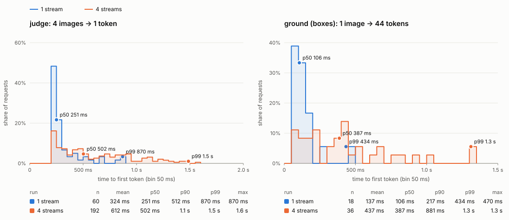
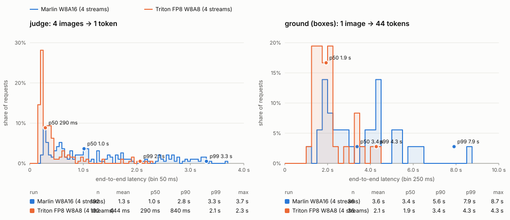
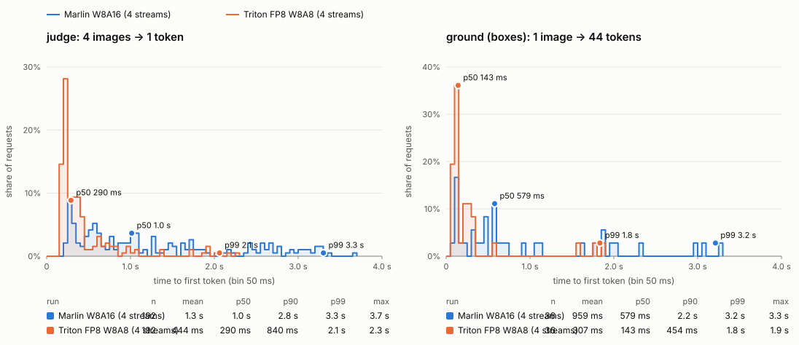

# realtime-vlm

**English** | [한국어](README.KR.md)


realtime-vlm takes up to four RTSP cameras / MP4 videos at once, uses a VLM (Vision-Language Model) to find whatever matches a **free-text prompt** (e.g. `a person falling`, `넘어지는 사람`, `a person walking`), and shows **where it is (bounding boxes) in real time**. Detections are kept in an event log with snapshots.

- **Input**: RTSP / MP4 (web upload or the `videos/` folder), up to 4 streams at once
- **Model**: Qwen3-VL-4B-Instruct-FP8 served by vLLM (runs on an RTX 4060 8GB)
- **Output**: bounding boxes for the prompt, a detection score, and an event log with snapshots
- **UI**: web page (2x2 grid + event panel)

---

## Contents
1. [Architecture](#architecture)
2. [Requirements](#requirements)
3. [Quick start](#quick-start)
4. [Using the UI](#using-the-ui)
5. [Inference strategy](#inference-strategy)
6. [Configuration](#configuration-configsconfigyaml)
7. [Development](#development)
8. [API](#api)
9. [Performance and limitations](#performance-and-limitations)
10. [Profiling](#profiling)
11. [Project layout](#project-layout)
12. [Sample video sources](#sample-video-sources)

---

## Architecture

```
 Browser ── http://127.0.0.1:8000 ──▶ frontend (Vite, React)
                                        │  proxies /api, /ws, /event-files
                                        ▼
                                      backend (FastAPI)            ◀── RTSP cameras / MP4
                                        │  decoding · frame sampling · event storage
                                        │  HTTP (OpenAI-compatible API)
                                        ▼
                                      serving (vLLM, GPU)
                                        Qwen3-VL-4B-Instruct-FP8
```

| Container | Role | Image | Port (127.0.0.1) |
|---|---|---|---|
| `realtime-vlm-serving` | VLM serving (GPU) | vllm/vllm-openai v0.33.0 | 9000 |
| `realtime-vlm-backend` | stream input, inference requests, events, REST/WS/MJPEG | python:3.12-slim + ffmpeg | 8001 (`/docs`) |
| `realtime-vlm-frontend` | web UI (Vite dev server) | node:22-slim | **8000** |

- **Source code is mounted as volumes, not baked into the images.** Code changes need no rebuild (backend auto-reloads, frontend uses HMR).
- The backend starts only after serving is healthy.
- The serving backend is selectable: `vllm` or `triton` (planned), via `serving.backend` in `configs/config.yaml`.

## Requirements

- NVIDIA GPU with 8 GB+ VRAM (tested on an RTX 4060 8GB)
- Docker + Docker Compose v2 + NVIDIA Container Toolkit
- On WSL2, set `memory=12GB` or more in `.wslconfig` (avoids running out of RAM while loading the model)

## Quick start

### 1. Prepare the model (`model_files/`)
The model is loaded from a local folder and nothing is downloaded at run time (`serving.offline: true`). Download it once:

```bash
sh build_docker.sh   # the download below uses the serving image, so build first

# default model (~5.7 GB)
docker run --rm --entrypoint python3 -u $(id -u):$(id -g) -e HF_HOME=/tmp/hf \
  -v $(pwd)/model_files:/workspace/model_files realtime-vlm-serving:latest -c \
  "from huggingface_hub import snapshot_download; snapshot_download('Qwen/Qwen3-VL-4B-Instruct-FP8', local_dir='/workspace/model_files/Qwen3-VL-4B-Instruct-FP8')"

# (optional) lighter alternative Qwen3-VL-2B-Instruct (~4 GB): change only the model name above
```

### 2. Build and run
```bash
sh build_docker.sh   # docker compose build (only when dependencies change)
sh run_docker.sh     # docker compose up -d
```
On the first start, vLLM takes 1–2 minutes to load and compile the model. Follow it with `docker compose logs -f serving`.

### 3. Open
- UI: **http://127.0.0.1:8000**
- API docs: http://127.0.0.1:8001/docs

### 4. Stop
```bash
docker compose down
```

## Using the UI

| Feature | How |
|---|---|
| Add a stream | Type `rtsp://...` or `videos/...mp4` in the top input (click it to see the file list), enter a prompt, press **추가 (Add)** |
| Add several at once | **MP4 업로드 (여러 개)** (Upload MP4, multiple): select several files; each is added as a stream while empty slots remain, the rest are only uploaded |
| Add from an empty slot | Click **＋ 빈 슬롯** (empty slot) to open an add form in place |
| Change the prompt | Edit the field under a tile and press **적용 (Apply)**; takes effect immediately |
| Per-stream settings | ⚙ on a tile: number of frames, window (s), request interval (ms), judge threshold |
| Detection | red border + `감지 0.xx` (detected) badge, boxes with labels over the video |
| Event log | right panel: filter by stream, clear, click for snapshot details |
| Remove a stream | ✕ on the tile |

- The last prompt used is remembered in the browser and becomes the default.
- Uploaded files are saved to `videos/uploads/`; duplicate names get a number (`name_1.mp4`).
- The UI labels are in Korean.

### Test RTSP cameras
Serves an mp4 from `videos/` as an RTSP camera on the compose network.
```bash
sh tools/rtsp_sim.sh videos/samples/urfd-fall-01-rgb.mp4 cam1   # enter rtsp://rtsp-sim:8554/cam1 in the UI
sh tools/rtsp_sim.sh videos/samples/people-detection.mp4 cam2
sh tools/rtsp_sim.sh stop
```
Typical camera URL formats:
- Hikvision: `rtsp://user:pw@IP:554/Streaming/Channels/101`
- Dahua: `rtsp://user:pw@IP:554/cam/realmonitor?channel=1&subtype=0`

## Inference strategy

The default is **two_stage** (`inference.strategy`):

1. **Judge**: send 4 frames sampled from the last 2 seconds, in time order, and ask yes/no: "does the prompt apply?". The probability of "yes" (from logprobs) is the **score**.
2. **Grounding**: if the score is at least `judge_threshold` (0.5), get the boxes from the last frame alone.

- The judge result is pushed over the WebSocket before the boxes, so the alert appears ~0.2 s after the frame and the boxes follow ~1 s later.
- Detections on the same stream within 5 seconds are merged into one event (`events.cooldown_sec`).

### Evaluation (4 UR Fall sample videos, every 0.25 s, prompt `넘어지는 사람` = "a person falling")

| Model | Strategy | Precision | Recall | F1 | False positives | Box IoU |
|---|---|---|---|---|---|---|
| 2B | multi_image (4 frames → boxes in one call) | 0.28 | 0.31 | 0.29 | 21 | 0.12 |
| 2B | two_stage, 4 frames | 0.60 | 0.96 | 0.74 | 17 | 0.98 |
| 4B-FP8 | two_stage, 1 frame | 0.92 | 0.85 | 0.88 | 2 | 0.98 |
| **4B-FP8** | **two_stage, 4 frames (default)** | **1.00** | **0.85** | **0.92** | **0** | **0.99** |

- Asking for boxes over 4 frames in one call breaks the coordinates, so 4 frames are used only for the judge and boxes come from a single frame.
- Every miss is in the first 0.25–0.5 s of a fall, i.e. detection lags by about that much.
- Only 4 videos were used; this needs re-validation on real CCTV footage.
- Re-run: `docker exec -w /workspace realtime-vlm-backend python3 backend/examples/eval_strategies.py`

## Configuration (`configs/config.yaml`)

One file shared by serving and backend. Backend values apply on save; serving values need `docker compose restart serving`.

| Section | Key | Default | Description |
|---|---|---|---|
| serving | `backend` | `vllm` | `vllm` \| `triton` (planned) |
| | `model_id` | `model_files/Qwen3-VL-4B-Instruct-FP8` | local model folder |
| | `gpu_memory_utilization` | `0.85` | for 4B; use 0.78 for 2B |
| | `max_model_len` | `2048` | for 4B; use 8192 for 2B |
| | `scheduling_policy` | `priority` | serve box requests before judge requests |
| | `extra_args` / `extra_env` | `"--linear-backend triton"` / `{}` | extra `vllm serve` flags / environment variables. The default selects real FP8 W8A8 GEMMs ([FP8 W8A8](#fp8-w8a8---linear-backend-triton)); profiling flags go here too (see below) |
| preprocess | `max_side` | `448` | long edge (px) of frames sent to the server; also used for the server's memory profiling and image size cap |
| inference | `strategy` | `two_stage` | `two_stage` \| `multi_image` \| `single_frame` |
| | `judge_threshold` | `0.5` | judge score threshold |
| | `num_frames` / `window_sec` | `4` / `2.0` | frames for the judge / time span they cover |
| stream | `max_streams` | `4` | concurrent streams |
| | `interval_ms` | `1000` | per-stream request interval (see performance below) |
| | `buffer_fps` / `buffer_max_side` | `10` / `960` | ring buffer rate / resolution (= snapshot resolution) |
| events | `cooldown_sec` | `5.0` | re-detections within this gap merge into one event |
| backend | `reload` | `true` | auto-reload on code changes |
| profiling | `enabled` | `false` | stage timing for `/api/profile` (also switchable at runtime) |

The env vars `SERVING` and `MODEL_ID` override serving values (e.g. `MODEL_ID=model_files/Qwen3-VL-2B-Instruct sh run_docker.sh`). Adjust the memory settings (`gpu_memory_utilization`, `max_model_len`) in the config to match.

## Development

| You changed | Then |
|---|---|
| `backend/app/**`, `configs/` | nothing (uvicorn auto-reload) |
| `frontend/src/**` | nothing (HMR, applied in the browser immediately) |
| `serving/*.sh`, serving values in the config | `docker compose restart serving` |
| `backend/requirements.txt`, `frontend/package.json`, vLLM version | `sh build_docker.sh && sh run_docker.sh` |

```bash
docker compose ps                         # status
docker compose logs -f backend            # logs (same for serving, frontend)
docker exec -it realtime-vlm-backend bash # shell (vim, net-tools, aliases included)

# run inference against the server directly (image / video / sweep a whole video)
sh backend/examples/run_vlm_inference.sh --video videos/samples/urfd-fall-01-rgb.mp4 --at 4 --prompt "넘어지는 사람"
sh backend/examples/run_vlm_inference.sh --video videos/samples/urfd-fall-01-rgb.mp4 --sweep 0.5 --prompt "넘어지는 사람"
#   → result images: data/inference/

# WebSocket stats (per-stream detection rate, latency)
docker exec realtime-vlm-backend python3 examples/ws_monitor.py --sec 20

# frontend type check
docker exec realtime-vlm-frontend npx tsc --noEmit
```

- The stream list lives in memory only. When the backend restarts (including auto-reload on code changes) streams are gone; events stay in `data/events/`.
- **Auto-reload can hang while a browser keeps an MJPEG preview open** (uvicorn waits for open connections to close: the log stops at `Waiting for connections to close`). Run `docker restart realtime-vlm-backend`.
- Backend and frontend run as the host user's UID, so files in `data/` and `videos/uploads/` are owned by you.

## API

Backend: `http://127.0.0.1:8001` (also reachable through the UI as `http://127.0.0.1:8000/api/...`)

| Method | Path | Description |
|---|---|---|
| GET | `/api/health` | serving status, model, inference settings |
| GET / POST | `/api/streams` | list / add `{url, prompt, name?, num_frames?, window_sec?, interval_ms?, judge_threshold?}` |
| GET / PATCH / DELETE | `/api/streams/{id}` | get / update settings / remove |
| GET | `/api/streams/{id}/mjpeg` | live video (`?overlay=1`: boxes drawn server-side) |
| GET | `/api/streams/{id}/snapshot` | latest frame as JPEG |
| GET | `/api/videos` | videos under `videos/` |
| POST | `/api/upload` | upload a video (multipart `file`) |
| GET / DELETE | `/api/events` | list events (`?stream_id=&limit=`) / clear all |
| GET | `/event-files/{YYYYMMDD}/{id}.jpg` | event snapshot |
| GET / POST | `/api/profile` | stage timing + CPU per thread / `?enabled=true&reset=true` turn on/off, reset (see [Profiling](#profiling)) |
| WS | `/ws` | `status` (every 1 s), `judge`, `result`, `event`, `error` messages |

## Performance and limitations

RTX 4060 8GB + Qwen3-VL-4B-FP8, 4 streams at once (1 RTSP + 3 MP4):

| Per-stream request interval | Judge only | Judge + boxes on detection (p90) |
|---|---|---|
| 250 ms | ~300 ms | ~4 s |
| 500 ms | ~300 ms | 2.5–4 s |
| **1000 ms (default)** | 200–300 ms | **~1.7 s** |

This table was measured on 2026-11-18 with the Marlin W8A16 kernel. Since the [FP8 W8A8](#fp8-w8a8---linear-backend-triton) switch (2026-11-23), `vllm bench serve` at the 4-stream load shows judge p50 0.8–1.0 s → ~0.3 s and box p50 ~3.4 → ~2.0 s (p99 ~7.8 → 3.5–4.3 s), with the same accuracy.

- **Generating the boxes (~44 tokens) is the bottleneck.** Each decode step is batched with other streams' judge requests. With a single stream it takes ~1 s. FP8 W8A8 made the judge prefills shorter, so decode steps wait less, but the decode itself (memory-bound, ~24 ms per token) did not get faster.
- **GPU memory is tight.** About 7.2 of 8 GB is used and the KV cache holds ~3,900 tokens (~3,300 before FP8 W8A8). If Windows uses a lot of GPU memory, serving may fail to start.
- **Live boxes are drawn for the frame that was analyzed**, so on moving targets they trail by about 1 s. Event snapshots are drawn on that same frame, so they are accurate.
- **Snapshot folder dates use the container's time zone (UTC).** Times in the UI use the browser's time zone.

## Profiling

Three tools, from cheap to expensive:

| Question | Tool |
|---|---|
| Is setting A faster than B? What are the latency percentiles at this load? | [`vllm bench serve`](#vllm-benchmark-vllm-bench-serve) (`bench_vllm.sh`): vLLM alone, one command per run |
| Where does the time of the whole service go (backend, network, vLLM)? | [whole-system profiling](#how-the-whole-system-was-profiled) (`metrics_scenario.sh`) |
| Why is vLLM slow (GPU timeline, engine loop)? | [inside vLLM](#inside-vllm): py-spy, torch profiler; only when a benchmark looks wrong |

### How the whole system was profiled

The first guess was "the VLM is the slowest part". Instead of assuming it, the whole pipeline
(decode → ring buffer → sample → preprocess → HTTP → vLLM → publish → WebSocket / MJPEG) was measured in three steps.
A line profiler (`line_profiler`, `cProfile`) was not used. Its per-line hooks slow the 30 fps decode loops enough to change the result. You also have to decide in advance which functions to decorate, which is the same guess again. `cProfile` only follows the main thread. And neither tool can tell CPU time from *waiting*: an inference thread spends almost all of its time blocked on HTTP.

1. **Stage timing with `perf_counter` (`backend/app/profiling.py`)**: answers where the latency of one inference cycle goes.
   - `prof.span("stage")` / `prof.add(...)` wrap each stage. Spans are kept per stage, and `GET /api/profile` returns count, rate, mean, p50/p90/p99/max and `busy` (seconds spent in the stage per wall-clock second).
   - Also recorded:
     - **frame age**: how old the newest frame is when the cycle starts, when the judge is published and when the result is published.
     - **asyncio loop lag**.
     - **CPU per thread**, read from `/proc/self/task/<native_id>/stat` and mapped to Python thread names (`src:*` decode, `infer:*` inference, `MainThread` asyncio). Whatever is left of the process total is native threads (ffmpeg, OpenCV).
   - Comparing the client-side HTTP time with vLLM's own `e2e` metric gives the network + API server cost.
   - Off by default (`profiling.enabled`); `POST /api/profile?enabled=true` turns it on and resets it at runtime. When off, each span costs one attribute check.
2. **Sampling profiler: py-spy**: answers which code spends the CPU, including C code (OpenCV, ffmpeg) and the GIL.
   - It attaches to the running process with no code change, sees every thread, and adds almost no overhead.
   - Two recordings run over the same window:
     - all threads with native frames (`--threads --native`, speedscope format)
     - only the thread holding the GIL (`--gil`, shows GIL contention)
   - The container has no `SYS_PTRACE`, so py-spy runs through `docker exec --privileged -u root`. This works without recreating the container, and py-spy is installed on first use.
   - With uvicorn `--reload`, the app is the reloader's child process (`spawn_main`, parent PID 1), not PID 1.
3. **Run a reproducible load and collect everything at once (`metrics_scenario.sh` → `profile_report.py`)**.
   - The script replaces all streams with N sample videos, optionally opens the MJPEG previews like the UI does, and warms up.
   - Over the same window it collects vLLM `/metrics` (`vllm_metrics.py`, incl. GPU utilization), WebSocket stats (`ws_monitor.py`), `/api/profile` and the two py-spy recordings.
   - `profile_report.py` merges them into one report:
     - stage table
     - per-cycle breakdown
     - client HTTP vs vLLM engine time
     - CPU per thread
     - py-spy hottest frames per thread group
     - GIL holders

```bash
# 1. stage timing by hand (streams running)
curl -X POST 'http://127.0.0.1:8001/api/profile?enabled=true'    # on + reset
curl -s http://127.0.0.1:8001/api/profile | python3 -m json.tool  # after a while

# 2. py-spy by hand (app = child of the uvicorn reloader)
docker exec -u root realtime-vlm-backend pip install py-spy
docker exec --privileged -u root realtime-vlm-backend py-spy dump --pid <app pid>
docker exec --privileged -u root realtime-vlm-backend py-spy top  --pid <app pid>

# 3. scenario: REMOVES all current streams, adds N sample videos with one prompt, warms up 10 s, collects all of the above
#   metrics_scenario.sh <label> <n_streams> <prompt> [interval_ms] [sec]
sh backend/examples/metrics_scenario.sh 4s-judgeonly 4 "불타는 자동차" 1000 60   # nothing matches: judge only
sh backend/examples/metrics_scenario.sh 4s-person    4 "사람"         1000 60   # always matches: judge + boxes every time
sh backend/examples/metrics_scenario.sh 4s-fall      4 "넘어지는 사람" 1000 60   # realistic
MJPEG=1 VIDEO_DIR=videos/samples-1080p PYSPY=0 \
  sh backend/examples/metrics_scenario.sh p4-1080p 4 "넘어지는 사람" 1000 60      # 1080p + live previews, no py-spy
#   options: MJPEG=1 pull every stream's preview (like the UI), VIDEO_DIR (default videos/samples),
#            PYSPY=0 skip py-spy, WARMUP (default 10 s)
#   → data/metrics/<label>.json (vLLM), .ws.txt, .profile.json, .pyspy.json, .gil.txt
python3 backend/examples/profile_report.py data/metrics/<label>   # print the combined report again

# vLLM metrics alone (while the UI / streams are running; Ctrl+C reports early)
python3 backend/examples/vllm_metrics.py --sec 60 --label my-test --out data/metrics/my-test.json --buckets
```

The sample videos are 320x240. They are smaller than `preprocess.max_side` (448), so they are sent as-is with fewer image tokens than a real camera. To load the system like 1080p cameras, make upscaled copies (aspect ratio is stretched to 16:9; fine for load tests):

```bash
mkdir -p videos/samples-1080p
for v in urfd-fall-01-rgb urfd-fall-02-rgb urfd-fall-05-rgb urfd-adl-01-rgb; do
  docker exec realtime-vlm-backend ffmpeg -v error -y -i /workspace/videos/samples/$v.mp4 \
    -vf scale=1920:1080:flags=lanczos,setsar=1 -c:v libx264 -preset veryfast -b:v 6M -an /workspace/videos/samples-1080p/$v.mp4
done
```

Main stages in `/api/profile` (ms):

| Stage | What it measures |
|---|---|
| `decode.read` / `decode.push` / `decode.buffer_resize` | `cap.read()` (ffmpeg decode) / storing the frame / resize to 960 for the ring buffer (under the lock) |
| `worker.sample` | picking N frames from the ring buffer |
| `infer.{judge,ground}.prep` | resize to 448 + JPEG + base64 of all frames of the request |
| `infer.{judge,ground}.encode` / `.http` / `.decode` | JSON encode / HTTP round trip (network + vLLM) / JSON decode; `.req_kb` = request size in KB |
| `worker.infer.1call` / `.2call` | whole `infer()` without / with grounding |
| `worker.publish`, `worker.event_store` | WebSocket hand-off, event + snapshot write |
| `worker.cycle` / `worker.idle` | one cycle without the interval wait / the wait |
| `age.sampled` / `age.judge` / `age.result` | age of the newest frame at cycle start / judge published / result published |
| `mjpeg.encode` | preview resize + JPEG per frame sent |
| `loop.lag` | asyncio event loop delay (stalls of REST / WS) |

Notes:
- **Run-to-run variation of the vLLM numbers is about ±10%** (same 1080p setup: e2e 862 / 954 / 993 ms). Repeat a run before trusting a difference.
- **py-spy `--native` stops the process ~50 times a second** to unwind C stacks. That roughly doubles the stage times of C-heavy code (e.g. `decode.read` 1.4 → 2.7 ms, `mjpeg.encode` 1.5 → 3.0 ms). Use `PYSPY=0` runs for stage times and py-spy runs for *where* CPU goes.
- py-spy `--native` reports threads blocked in a lock or syscall as active. The report puts those samples in a separate "blocked" count.
- Spans that started before a reset are dropped, so a window never mixes a whole cycle with only part of its sub-stages. Cycles still running at the end of the window can still make the per-cycle sum off by about 1%.
- Client HTTP vs vLLM `e2e` can only be compared to within tens of ms with 4 streams: the two tools' windows differ by 1–2 s, and a few 5–10 s requests move the means. With 1 stream the difference was 2.6 ms.

#### vLLM metrics

vLLM exposes Prometheus metrics at `http://127.0.0.1:9000/metrics`. `backend/examples/vllm_metrics.py` takes a snapshot before and after a time window, so the numbers cover only requests that finished inside that window. It also samples running/waiting requests, KV cache usage and GPU utilization (`nvidia-smi`) during the window. It uses only the Python standard library and runs on the host or in the backend container (`--url http://serving:9000`).

What the output means:

| Line | Meaning |
|---|---|
| end-to-end | server-side time of one request = queue + prefill + decode |
| queue | waiting for the scheduler (0 = never queued) |
| prefill | from scheduling to the first token: vision encoder + prompt processing (judge: 4 images ~410 tokens, boxes: 1 image ~200 tokens) |
| decode | generating the output tokens (judge: 1 token, boxes: ~44 tokens) |
| inter-token latency | time per decode step; grows when another stream's prefill shares the step |
| tokens / engine step | how many tokens the GPU processed per step (batch size) |
| multimodal cache hit | images whose processing was reused (consecutive requests share frames) |
| client side (ws.txt) | latency seen by the backend, incl. preprocessing and HTTP; `det p90` = judge + boxes |

Notes:
- **Judge and box requests are mixed in the same histograms.** Use scenarios (nothing matches / always matches) to separate them, and compare the client-side numbers.
- **The mean is exact; percentiles are only upper bounds (`p90<=`)** because vLLM's buckets are coarse (queue / prefill / decode: 0.3, 0.5, 0.8, 1.0, 1.5 s...).
- Counters reset when serving restarts; a restart inside the window gives wrong numbers.

### Results

#### Whole system (2026-11-20, 4B-FP8, 4 streams, `넘어지는 사람`, interval 1000 ms, 4 MJPEG viewers)

| Input | prompt tokens / req | vLLM e2e | prefill | decode | latency p90 | detection p90 (judge + boxes) | GPU | backend CPU |
|---|---|---|---|---|---|---|---|---|
| 320x240 samples | 354 | 500 ms | 205 ms | 240 ms | 0.4–1.9 s | 1.9–2.0 s | 95% | 0.26 cores |
| 1080p (3 runs) | 465–469 | 862–993 ms | 348–434 ms | 337–407 ms | 0.7–5.9 s | 5.4–6.5 s | 98–99% | 1.4 cores |
| 1080p, interval 0 | 494 | 1,132 ms | 416 ms | 586 ms | 0.7–9.1 s | 8.8–9.5 s | 100% | 1.6 cores |

Where one inference cycle goes (1080p, no py-spy, mean of 155 cycles = 1,131 ms):

| Part | Mean | Share |
|---|---|---|
| sample frames from the ring buffer | 0.0 ms | 0% |
| preprocess (resize + JPEG + base64) | 5.6 ms | 0.5% |
| JSON encode / decode, publish, event store | 0.6 ms | 0.1% |
| **vLLM HTTP round trips (judge + boxes)** | **1,140 ms** | **~99%** |

- **The VLM is the bottleneck (measured, not assumed).**
  - The backend's own work is ~6 ms per cycle.
  - Network + vLLM API server costs less than the measurement can resolve (2.6 ms with 1 stream).
  - The GPU is 98–99% busy.
- **The backend is not under load.**
  - It uses 1.4 of 16 cores, and 1.06 of those are ffmpeg decoding 4 × 1080p × 30 fps (~0.3 core per stream).
  - The GIL is held only ~6% of the time, and the event loop lag is under 1 ms at p99.
  - CPU matters only for scaling to more streams, not for latency.
- **The 320x240 sample videos give optimistic numbers.** They are not upscaled to 448, so each request has ~25% fewer prompt tokens. vLLM time roughly doubles with 1080p input (500 → 860–990 ms), and detection p90 grows from ~2 s to ~6 s.
- **1080p showed a long tail that 320x240 didn't.**
  - Judge HTTP: p50 350 ms but p99 3.8 s. vLLM prefill p99 fell in the ≤5 s bucket.
  - There was no queueing and no preemption.
  - It disappeared after restarting serving (judge p99 0.59 s). See [inside vLLM](#inside-vllm).
- **`interval_ms: 0` does not help.** Throughput rises only ~12%. The stream with no detections (judge only) gets 1.9 req/s while the detecting streams drop to 0.3–0.5 req/s with detection p90 ~9 s.
- Frames are ~50 ms old when a cycle starts (ring buffer at 10 fps), which is negligible.

#### vLLM only

First vLLM-only results (2026-11-19, 4B-FP8, interval 1000 ms, sample videos 320x240, no preview viewers):

| Scenario | req/s (server) | prefill mean | decode mean | inter-token mean | client latency | GPU util |
|---|---|---|---|---|---|---|
| 1 stream, always matches | 1.95 | 92 ms | 372 ms | 19 ms | 960 ms (judge+boxes) | 90% |
| 4 streams, judge only | 4.00 | 346 ms | 0 | – | 172 / 340 / 538 / 566 ms by stream | 61% |
| 4 streams, always matches | 5.07 | 161 ms | 564 ms | 29 ms (p99 ≤150 ms) | ~1.55 s, only 0.65 of 1 req/s per stream | 100% |
| 4 streams, falls (realistic) | 4.28 | 192 ms | 258 ms | 29 ms | no detection ~330 ms, detection p90 ~1.8 s | 97% |

- **Box decoding dominates detection latency.** ~44 tokens × 18 ms (alone) – 29 ms (4 streams) = 0.8–1.3 s of the ~1.7 s. 18 ms/token for one sequence is close to the time to read the weights once from GPU memory (memory-bandwidth bound), so the lever is fewer output tokens, not faster kernels.
- **Judges of the 4 streams are processed one after another** (~170 ms each), because all streams fire at the same moment. Their latency stacks up to 566 ms even though the GPU is only ~60% busy.
- ~170 ms of prefill for ~410 tokens looked more than plain compute would suggest. The torch profiler answered this: it is plain compute (see [inside vLLM](#inside-vllm)).

### Inside vLLM

Done the same way as the backend: first py-spy without a restart, then the GPU timeline.

1. **py-spy on the API server (PID 1) and the EngineCore process** (`--idle`, so waiting is included), under the 4 × 1080p load.
   - Run it with `docker exec --privileged realtime-vlm-serving py-spy record --pid <pid> --threads --idle`.
   - The samples are in time order, so long runs of the same stack show where the engine loop stalls.
2. **torch profiler (GPU timeline)**. It needs a serving restart with these settings:

   ```yaml
   serving:
     extra_args: "--linear-backend triton --profiler-config.profiler=torch --profiler-config.torch_profiler_dir=/tmp/vllm_prof --profiler-config.torch_profiler_with_stack=false"
   ```

   - Then `curl -X POST http://127.0.0.1:9000/start_profile`, wait a few seconds, and `curl -X POST .../stop_profile`.
   - Copy the result with `docker cp realtime-vlm-serving:/tmp/vllm_prof .`. `rank0.*.pt.trace.json.gz` opens in Perfetto; `rank0.profiler_out.txt` is a CUDA time table per kernel.
   - Starting and stopping the profiler stalls the engine for seconds, so leave those requests out of latency numbers.
   - `--enable-logging-iteration-details` adds one log line per engine step (prefill / decode requests, tokens, encoder inputs). It shows what each step contained. With async scheduling the logged time is not GPU time.
3. **A/B by restarting serving with one setting changed** (`extra_env` for environment variables).

Findings (2026-11-20, 4 × 1080p, interval 1000 ms):

| Step (torch profiler, 6 s) | GPU time per step |
|---|---|
| decode only (1–3 sequences) | ~15 ms |
| + 1 judge prefill (4 images, 536 tokens) | ~195 ms |
| + 2 judge prefills (1,072 tokens) | ~378 ms |
| + 1 box prefill (1 image, 146 tokens; the image is reused from the judge's encoder output) | ~50 ms |

- **The GPU is 98% busy and the kernels are efficient.**
  - The longest GPU idle gap in 6 s was 6 ms.
  - The FP8 GEMMs (Marlin, before the [FP8 W8A8](#fp8-w8a8---linear-backend-triton) switch) take 43% of GPU time. A judge prefill computes ~3.9 TFLOP in ~112 ms (~35 TFLOPS), close to what an RTX 4060 can do in bf16. The prefill is compute-bound; it is not a slow kernel.
  - The vision encoder (bf16, no CUDA graph) takes ~14%.
- **The vLLM API server is idle 98% of the time.** Image decoding and the HF processor cost almost nothing, because consecutive requests share frames and hit the processor cache.
- **The engine loop "stalls" are the CPU waiting for a busy GPU.**
  - py-spy showed single calls blocking for 0.4–1.3 s (`Event.synchronize`, a triton kernel launch, the image tensor copy to the GPU).
  - The GPU timeline shows no gap at the same time, so the GPU was working.
- **Pinned memory has no measurable effect.**
  - Under WSL, vLLM turns pinned memory off. Image tensors are then copied from pageable memory, and the engine thread blocks until earlier GPU work is done (9% of its time).
  - `VLLM_WSL2_ENABLE_PIN_MEMORY=1` removes that wait, but latency changes by only −5% (e2e 639 → 608 ms), within the run-to-run variation, and it uses 107 MiB more VRAM. Left off.
- **The 1080p long tail went away after a serving restart.** Same load: e2e 862–993 → 639 ms, judge p99 3.8 → 0.59 s, box p99 6.3 → 2.5 s. Serving had been up ~2 hours before. Whether it degrades with uptime is not confirmed yet; it needs a long run that samples latency over time.

### vLLM benchmark (`vllm bench serve`)

To compare settings, benchmark vLLM alone with vLLM's own benchmark tool, with no backend and no video streams.

- `backend/examples/bench_vllm.sh` sends this service's two request shapes at the same time as Poisson traffic (`--dataset-name random-mm`):
  - judge: 4 images 448x252 + ~88 text tokens → 1 token
  - ground (boxes): 1 image 448x252 + ~34 text tokens → 44 tokens
- It prints TTFT / e2e percentiles per request type. It saves the full `vllm bench` result and a histogram JSON per type:
  - e2e and TTFT, each with n / mean / p50 / p90 / p99 / max
  - fixed bins (`lo`, `hi`, `count`)
  - the raw samples in ms
- `backend/examples/plot_latency_hist.py` draws the histograms of several runs as one SVG (standard library only).
- The images are random noise, so vLLM's multimodal caches never hit. That makes the numbers slightly worse than in the real service, which reuses frames.

```bash
# stop the UI streams first (they would add load)
#   bench_vllm.sh <label> [judge_rps] [ground_rps] [sec]
sh backend/examples/bench_vllm.sh 1s 1.0 0.3 60    # ~ 1 stream, interval 1000 ms, falls (~30% detections)
sh backend/examples/bench_vllm.sh 4s 3.2 0.6 60    # ~ 4 streams
#   → data/metrics/bench/<label>.{judge,ground}.json, <label>.{judge,ground}.hist.json, console summary
python3 backend/examples/plot_latency_hist.py "1s:1 stream" "4s:4 streams"                 # e2e
python3 backend/examples/plot_latency_hist.py "1s:1 stream" "4s:4 streams" --metric ttft   # time to first token
#   → data/metrics/bench/latency_hist_1s_4s_{e2e,ttft}.svg
```

Results (2026-11-20, 4B-FP8, 60 s each):




| Load | Request | n | e2e p50 | e2e p90 | e2e p99 | TTFT p50 | TTFT p99 | time per output token |
|---|---|---|---|---|---|---|---|---|
| 1 stream (judge 1.0/s + boxes 0.3/s) | judge | 60 | 251 ms | 512 ms | 870 ms | 251 ms | 870 ms | – |
| | ground | 18 | 1.1 s | 1.3 s | 1.4 s | 106 ms | 434 ms | 23 ms |
| 4 streams (judge 3.2/s + boxes 0.6/s) | judge | 192 | 502 ms | 1.1 s | 1.5 s | 502 ms | 1.5 s | – |
| | ground | 36 | 2.4 s | 4.3 s | 5.7 s | 387 ms | 1.3 s | 52 ms |

- **Box requests are where 4 streams hurt.**
  - Alone, a box request takes ~1.1 s. With 4 streams it takes 2.4 s at p50 and 5.7 s at p99, and the distribution spreads from 1.5 to 6.3 s.
  - TTFT stays ≤1.3 s. Most of the extra time comes while the 44 tokens are generated: the time per token grows from 23 to 52 ms. Other streams' judge prefills (~195 ms each) run in the same engine steps as the box decode, so each decode step can wait for a whole prefill.
- **Judge latency doubles** (p50 251 → 502 ms), because 3.2 judges/s × ~195 ms keeps the GPU busy ~60% of the time with judges alone.
- With 1 stream there are only 18 box requests in 60 s, so their p99 is rough.
- Next steps to compare with this script:
  - smaller prefill chunks (`--max-num-batched-tokens`), so decode steps wait less
  - fewer box output tokens
  - `scheduling_policy` fcfs vs priority

### FP8 W8A8 (`--linear-backend triton`)

The model is `Qwen3-VL-4B-Instruct-FP8` (LLM weights FP8 e4m3, 128x128 blocks; vision encoder and `lm_head` bf16). The RTX 4060 (Ada, sm_89) has FP8 tensor cores, but vLLM v0.33 still picked `MarlinFP8ScaledMMLinearKernel` and logged "Your GPU does not have native support for FP8 computation". That kernel is weight-only FP8 (W8A16): it unpacks the weights and multiplies in bf16.
- For block FP8 on CUDA, vLLM tries the kernels in this order: FlashInfer/DeepGEMM, CUTLASS block (sm_90+ only), B12x, **Marlin**, Triton. On sm_89, Marlin comes before Triton, so Marlin wins.
- `serving.extra_args: "--linear-backend triton"` selects `TritonFp8BlockScaledMMKernel` instead: activations are quantized to FP8 per token group and the GEMM runs on the FP8 tensor cores (W8A8). The model files stay the same.
- INT8 W8A8 would run at about the same tensor-core rate on Ada, and it needs a different checkpoint or our own calibration. FP8 W8A8 gives the same gain with the current model.

Results (2026-11-23, `vllm bench serve` via `bench_vllm.sh`, 60 s each; both configurations measured the same day on a freshly restarted serving; 4-stream load run twice):





| Load | Request | Marlin W8A16 (before) p50 / p90 / p99 | Triton FP8 W8A8 (after) p50 / p90 / p99 | time per output token |
|---|---|---|---|---|
| 1 stream | judge e2e | 249 / 516 / 894 ms | **198 / 497 / 691 ms** | – |
| | ground e2e | 1124 / 1357 / 1728 ms | 1153 / 1289 / 1503 ms | 23.6 → 24.2 ms |
| 4 streams, run 1 | judge e2e | 1014 / 2793 / 3301 ms | **290 / 840 / 2062 ms** | – |
| | ground e2e | 3379 / 5599 / 7908 ms | **1931 / 3417 / 4274 ms** | 60.9 → 41.8 ms |
| 4 streams, run 2 | judge e2e | 804 / 1511 / 2133 ms | **309 / 929 / 1316 ms** | – |
| | ground e2e | 3407 / 5560 / 7778 ms | **1987 / 2995 / 3549 ms** | 64.5 → 42.1 ms |

- **Prefill gets faster, so the 4-stream load stops piling up.** A judge alone is ~20% faster (p50 249 → 198 ms). With 4 streams the judge p50 drops about 3x (0.8–1.0 s → ~0.3 s), and box requests about 1.7x (p50 ~3.4 → ~2.0 s, p99 ~7.8 → 3.5–4.3 s), because the judge prefills they share engine steps with are shorter.
- **Decode alone does not change** (23.6 → 24.2 ms per token with 1 stream). Decode is limited by memory bandwidth, and the weights were already 8-bit, so the same bytes are read.
- **More KV cache**: 3,280 → 3,872 tokens (weights 5.85 → 5.79 GiB; the rest of the difference was not investigated).
- **Accuracy is unchanged** (`eval_strategies.py --strategies two_stage`, 4 UR Fall videos): precision 1.00, recall 0.85, F1 0.92, FP 0, FN 4 as before; IoU 0.98 (was 0.99). Judge scores move by 0.009 on average; the largest negative score is 0.048 (was 0.037), still far below the 0.5 threshold.
- The 4-stream Marlin baseline here is worse than the 2026-11-20 run above (judge p50 0.8–1.0 s vs 502 ms). At this load the GPU is close to saturation, so runs vary a lot; compare runs from the same day only.

## Project layout

```
realtime-vlm/
├── README.md, README.KR.md, PLAN.md
├── docker-compose.yml
├── build_docker.sh              # docker compose build
├── run_docker.sh                # docker compose up -d
├── serving.conf                 # supervisord program for the old single-container setup (entrypoint.sh); not used by docker compose
├── configs/config.yaml          # all settings
├── serving/
│   ├── Dockerfile               # based on vllm/vllm-openai
│   ├── entrypoint.sh            # runs vllm | triton depending on SERVING
│   ├── gen_env.py               # config.yaml → vLLM arguments
│   └── vllm.sh
├── backend/
│   ├── Dockerfile, requirements.txt, start.sh
│   ├── app/
│   │   ├── main.py              # REST, WS, MJPEG, upload
│   │   ├── config.py, schemas.py
│   │   ├── inference/           # preprocess, prompts, parser, vllm_client (strategies)
│   │   ├── streams/             # source (RTSP/MP4, ring buffer), worker (inference loop), manager
│   │   ├── events/store.py      # events, snapshots, jsonl
│   │   └── profiling.py         # stage timing + CPU per thread (/api/profile)
│   └── examples/                # run_vlm_inference, eval_strategies, ws_monitor, vllm_metrics,
│                                # metrics_scenario.sh, profile_report, bench_vllm.sh, plot_latency_hist
├── frontend/
│   ├── Dockerfile, package.json, vite.config.ts
│   └── src/                     # App, useLive (WS), components/ (AddStreamForm, StreamTile, EventPanel)
├── tools/rtsp_sim.sh            # test RTSP camera
├── images/                      # README images (UI screenshot, latency histograms)
├── model_files/                 # models (not in git)
├── videos/                      # input videos, uploads/ (not in git)
└── data/                        # events/, inference/ (not in git)
```

## Sample video sources

`videos/samples/` is not in git. Sources and licenses are listed in `videos/samples/SOURCES.md`.

| File | Source | License |
|---|---|---|
| `urfd-fall-01/02/05-rgb.mp4`, `urfd-adl-01-rgb.mp4` | [UR Fall Detection Dataset](http://fenix.ur.edu.pl/~mkepski/ds/uf.html) (RGB half cropped) | CC BY-NC-SA 4.0 (non-commercial academic use) |
| `people-detection.mp4` | [intel-iot-devkit/sample-videos](https://github.com/intel-iot-devkit/sample-videos) | CC BY 4.0 |

## Roadmap
- [x] P0 Docker + vLLM serving
- [x] P1 strategy / model evaluation (4B-FP8, two_stage)
- [x] P2 stream input, workers, API
- [x] P3 event log
- [x] P4 web UI
- [x] split into containers (serving / backend / frontend)
- [ ] P5 stabilization and tuning: fewer box output tokens, 4-stream load test
  - [x] profiling (whole system, vLLM internals, `vllm bench serve`)
  - [x] FP8 W8A8 GEMMs (`--linear-backend triton`): 4-stream judge ~3x, box ~1.7x faster, same accuracy
- [ ] P6 Triton serving comparison
