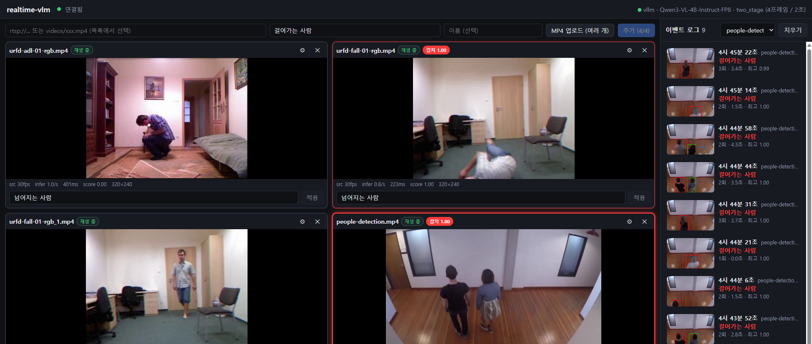

# realtime-vlm

**English** | [한국어](README.KR.md)



realtime-vlm takes up to four RTSP cameras / MP4 videos at once, uses a VLM (Vision-Language Model) to find whatever matches a **free-text prompt** (e.g. `a person falling`, `넘어지는 사람`, `a person walking`), and shows **where it is (bounding boxes) in real time**. Detections are kept in an event log with snapshots.

- **Input**: RTSP / MP4 (web upload or the `videos/` folder), up to 4 streams at once
- **Model**: Qwen3-VL-4B-Instruct-FP8 served by vLLM (runs on an RTX 4060 8GB)
- **Output**: bounding boxes for the prompt, a detection score, and an event log with snapshots
- **UI**: web page (2x2 grid + event panel)

---

## Contents
1. [Architecture](#architecture)
2. [Requirements](#requirements)
3. [Quick start](#quick-start)
4. [Using the UI](#using-the-ui)
5. [Inference strategy](#inference-strategy)
6. [Configuration](#configuration-configsconfigyaml)
7. [Development](#development)
8. [API](#api)
9. [Performance and limitations](#performance-and-limitations)
10. [Project layout](#project-layout)
11. [Sample video sources](#sample-video-sources)

---

## Architecture

```
 Browser ── http://127.0.0.1:8000 ──▶ frontend (Vite, React)
                                        │  proxies /api, /ws, /event-files
                                        ▼
                                      backend (FastAPI)            ◀── RTSP cameras / MP4
                                        │  decoding · frame sampling · event storage
                                        │  HTTP (OpenAI-compatible API)
                                        ▼
                                      serving (vLLM, GPU)
                                        Qwen3-VL-4B-Instruct-FP8
```

| Container | Role | Image | Port (127.0.0.1) |
|---|---|---|---|
| `realtime-vlm-serving` | VLM serving (GPU) | vllm/vllm-openai v0.33.0 | 9000 |
| `realtime-vlm-backend` | stream input, inference requests, events, REST/WS/MJPEG | python:3.12-slim + ffmpeg | 8001 (`/docs`) |
| `realtime-vlm-frontend` | web UI (Vite dev server) | node:22-slim | **8000** |

- **Source code is mounted as volumes, not baked into the images.** Code changes need no rebuild (backend auto-reloads, frontend uses HMR).
- The backend starts only after serving is healthy.
- The serving backend is selectable: `vllm` or `triton` (planned), via `serving.backend` in `configs/config.yaml`.

## Requirements

- NVIDIA GPU with 8 GB+ VRAM (tested on an RTX 4060 8GB)
- Docker + Docker Compose v2 + NVIDIA Container Toolkit
- On WSL2, set `memory=12GB` or more in `.wslconfig` (avoids running out of RAM while loading the model)

## Quick start

### 1. Prepare the model (`model_files/`)
The model is loaded from a local folder and nothing is downloaded at run time (`serving.offline: true`). Download it once:

```bash
sh build_docker.sh   # the download below uses the serving image, so build first

# default model (~5.7 GB)
docker run --rm --entrypoint python3 -u $(id -u):$(id -g) -e HF_HOME=/tmp/hf \
  -v $(pwd)/model_files:/workspace/model_files realtime-vlm-serving:latest -c \
  "from huggingface_hub import snapshot_download; snapshot_download('Qwen/Qwen3-VL-4B-Instruct-FP8', local_dir='/workspace/model_files/Qwen3-VL-4B-Instruct-FP8')"

# (optional) lighter alternative Qwen3-VL-2B-Instruct (~4 GB): change only the model name above
```

### 2. Build and run
```bash
sh build_docker.sh   # docker compose build (only when dependencies change)
sh run_docker.sh     # docker compose up -d
```
On the first start, vLLM takes 1–2 minutes to load and compile the model. Follow it with `docker compose logs -f serving`.

### 3. Open
- UI: **http://127.0.0.1:8000**
- API docs: http://127.0.0.1:8001/docs

### 4. Stop
```bash
docker compose down
```

## Using the UI

| Feature | How |
|---|---|
| Add a stream | Type `rtsp://...` or `videos/...mp4` in the top input (click it to see the file list), enter a prompt, press **추가 (Add)** |
| Add several at once | **MP4 업로드 (여러 개)** (Upload MP4, multiple): select several files; each is added as a stream while empty slots remain, the rest are only uploaded |
| Add from an empty slot | Click **＋ 빈 슬롯** (empty slot) to open an add form in place |
| Change the prompt | Edit the field under a tile and press **적용 (Apply)**; takes effect immediately |
| Per-stream settings | ⚙ on a tile: number of frames, window (s), request interval (ms), judge threshold |
| Detection | red border + `감지 0.xx` (detected) badge, boxes with labels over the video |
| Event log | right panel: filter by stream, clear, click for snapshot details |
| Remove a stream | ✕ on the tile |

- The last prompt used is remembered in the browser and becomes the default.
- Uploaded files are saved to `videos/uploads/`; duplicate names get a number (`name_1.mp4`).
- The UI labels are in Korean.

### Test RTSP cameras
Serves an mp4 from `videos/` as an RTSP camera on the compose network.
```bash
sh tools/rtsp_sim.sh videos/samples/urfd-fall-01-rgb.mp4 cam1   # enter rtsp://rtsp-sim:8554/cam1 in the UI
sh tools/rtsp_sim.sh videos/samples/people-detection.mp4 cam2
sh tools/rtsp_sim.sh stop
```
Typical camera URL formats:
- Hikvision: `rtsp://user:pw@IP:554/Streaming/Channels/101`
- Dahua: `rtsp://user:pw@IP:554/cam/realmonitor?channel=1&subtype=0`

## Inference strategy

The default is **two_stage** (`inference.strategy`):

1. **Judge**: send 4 frames sampled from the last 2 seconds, in time order, and ask yes/no: "does the prompt apply?". The probability of "yes" (from logprobs) is the **score**.
2. **Grounding**: if the score is at least `judge_threshold` (0.5), get the boxes from the last frame alone.

- The judge result is pushed over the WebSocket before the boxes, so the alert appears ~0.2 s after the frame and the boxes follow ~1 s later.
- Detections on the same stream within 5 seconds are merged into one event (`events.cooldown_sec`).

### Evaluation (4 UR Fall sample videos, every 0.25 s, prompt `넘어지는 사람` = "a person falling")

| Model | Strategy | Precision | Recall | F1 | False positives | Box IoU |
|---|---|---|---|---|---|---|
| 2B | multi_image (4 frames → boxes in one call) | 0.28 | 0.31 | 0.29 | 21 | 0.12 |
| 2B | two_stage, 4 frames | 0.60 | 0.96 | 0.74 | 17 | 0.98 |
| 4B-FP8 | two_stage, 1 frame | 0.92 | 0.85 | 0.88 | 2 | 0.98 |
| **4B-FP8** | **two_stage, 4 frames (default)** | **1.00** | **0.85** | **0.92** | **0** | **0.99** |

- Asking for boxes over 4 frames in one call breaks the coordinates, so 4 frames are used only for the judge and boxes come from a single frame.
- Every miss is in the first 0.25–0.5 s of a fall, i.e. detection lags by about that much.
- Only 4 videos were used; this needs re-validation on real CCTV footage.
- Re-run: `docker exec -w /workspace realtime-vlm-backend python3 backend/examples/eval_strategies.py`

## Configuration (`configs/config.yaml`)

One file shared by serving and backend. Backend values apply on save; serving values need `docker compose restart serving`.

| Section | Key | Default | Description |
|---|---|---|---|
| serving | `backend` | `vllm` | `vllm` \| `triton` (planned) |
| | `model_id` | `model_files/Qwen3-VL-4B-Instruct-FP8` | local model folder |
| | `gpu_memory_utilization` | `0.85` | for 4B; use 0.78 for 2B |
| | `max_model_len` | `2048` | for 4B; use 8192 for 2B |
| | `scheduling_policy` | `priority` | serve box requests before judge requests |
| preprocess | `max_side` | `448` | long edge (px) of frames sent to the server; also used for the server's memory profiling and image size cap |
| inference | `strategy` | `two_stage` | `two_stage` \| `multi_image` \| `single_frame` |
| | `judge_threshold` | `0.5` | judge score threshold |
| | `num_frames` / `window_sec` | `4` / `2.0` | frames for the judge / time span they cover |
| stream | `max_streams` | `4` | concurrent streams |
| | `interval_ms` | `1000` | per-stream request interval (see performance below) |
| | `buffer_fps` / `buffer_max_side` | `10` / `960` | ring buffer rate / resolution (= snapshot resolution) |
| events | `cooldown_sec` | `5.0` | re-detections within this gap merge into one event |
| backend | `reload` | `true` | auto-reload on code changes |

The env vars `SERVING` and `MODEL_ID` override serving values (e.g. `MODEL_ID=model_files/Qwen3-VL-2B-Instruct sh run_docker.sh`). Adjust the memory settings (`gpu_memory_utilization`, `max_model_len`) in the config to match.

## Development

| You changed | Then |
|---|---|
| `backend/app/**`, `configs/` | nothing (uvicorn auto-reload) |
| `frontend/src/**` | nothing (HMR, applied in the browser immediately) |
| `serving/*.sh`, serving values in the config | `docker compose restart serving` |
| `backend/requirements.txt`, `frontend/package.json`, vLLM version | `sh build_docker.sh && sh run_docker.sh` |

```bash
docker compose ps                         # status
docker compose logs -f backend            # logs (same for serving, frontend)
docker exec -it realtime-vlm-backend bash # shell (vim, net-tools, aliases included)

# run inference against the server directly (image / video / sweep a whole video)
sh backend/examples/run_vlm_inference.sh --video videos/samples/urfd-fall-01-rgb.mp4 --at 4 --prompt "넘어지는 사람"
sh backend/examples/run_vlm_inference.sh --video videos/samples/urfd-fall-01-rgb.mp4 --sweep 0.5 --prompt "넘어지는 사람"
#   → result images: data/inference/

# WebSocket stats (per-stream detection rate, latency)
docker exec realtime-vlm-backend python3 examples/ws_monitor.py --sec 20

# frontend type check
docker exec realtime-vlm-frontend npx tsc --noEmit
```

- The stream list lives in memory only. When the backend restarts (including auto-reload on code changes) streams are gone; events stay in `data/events/`.
- Backend and frontend run as the host user's UID, so files in `data/` and `videos/uploads/` are owned by you.

## API

Backend: `http://127.0.0.1:8001` (also reachable through the UI as `http://127.0.0.1:8000/api/...`)

| Method | Path | Description |
|---|---|---|
| GET | `/api/health` | serving status, model, inference settings |
| GET / POST | `/api/streams` | list / add `{url, prompt, name?, num_frames?, window_sec?, interval_ms?, judge_threshold?}` |
| GET / PATCH / DELETE | `/api/streams/{id}` | get / update settings / remove |
| GET | `/api/streams/{id}/mjpeg` | live video (`?overlay=1`: boxes drawn server-side) |
| GET | `/api/streams/{id}/snapshot` | latest frame as JPEG |
| GET | `/api/videos` | videos under `videos/` |
| POST | `/api/upload` | upload a video (multipart `file`) |
| GET / DELETE | `/api/events` | list events (`?stream_id=&limit=`) / clear all |
| GET | `/event-files/{YYYYMMDD}/{id}.jpg` | event snapshot |
| WS | `/ws` | `status` (every 1 s), `judge`, `result`, `event`, `error` messages |

## Performance and limitations

RTX 4060 8GB + Qwen3-VL-4B-FP8, 4 streams at once (1 RTSP + 3 MP4):

| Per-stream request interval | Judge only | Judge + boxes on detection (p90) |
|---|---|---|
| 250 ms | ~300 ms | ~4 s |
| 500 ms | ~300 ms | 2.5–4 s |
| **1000 ms (default)** | 200–300 ms | **~1.7 s** |

- **Generating the boxes (~44 tokens) is the bottleneck.** Each decode step is batched with other streams' judge requests. With a single stream it takes ~1 s.
- **GPU memory is tight.** About 7.2 of 8 GB is used and the KV cache holds ~3,200 tokens. If Windows uses a lot of GPU memory, serving may fail to start.
- **Live boxes are drawn for the frame that was analyzed**, so on moving targets they trail by about 1 s. Event snapshots are drawn on that same frame, so they are accurate.
- **Snapshot folder dates use the container's time zone (UTC).** Times in the UI use the browser's time zone.

## Project layout

```
realtime-vlm/
├── README.md, README.KR.md, PLAN.md
├── docker-compose.yml
├── build_docker.sh              # docker compose build
├── run_docker.sh                # docker compose up -d
├── configs/config.yaml          # all settings
├── serving/
│   ├── Dockerfile               # based on vllm/vllm-openai
│   ├── entrypoint.sh            # runs vllm | triton depending on SERVING
│   ├── gen_env.py               # config.yaml → vLLM arguments
│   └── vllm.sh
├── backend/
│   ├── Dockerfile, requirements.txt, start.sh
│   ├── app/
│   │   ├── main.py              # REST, WS, MJPEG, upload
│   │   ├── config.py, schemas.py
│   │   ├── inference/           # preprocess, prompts, parser, vllm_client (strategies)
│   │   ├── streams/             # source (RTSP/MP4, ring buffer), worker (inference loop), manager
│   │   └── events/store.py      # events, snapshots, jsonl
│   └── examples/                # run_vlm_inference, eval_strategies, ws_monitor
├── frontend/
│   ├── Dockerfile, package.json, vite.config.ts
│   └── src/                     # App, useLive (WS), components/ (AddStreamForm, StreamTile, EventPanel)
├── tools/rtsp_sim.sh            # test RTSP camera
├── images/                      # README images
├── model_files/                 # models (not in git)
├── videos/                      # input videos, uploads/ (not in git)
└── data/                        # events/, inference/ (not in git)
```

## Sample video sources

`videos/samples/` is not in git. Sources and licenses are listed in `videos/samples/SOURCES.md`.

| File | Source | License |
|---|---|---|
| `urfd-fall-01/02/05-rgb.mp4`, `urfd-adl-01-rgb.mp4` | [UR Fall Detection Dataset](http://fenix.ur.edu.pl/~mkepski/ds/uf.html) (RGB half cropped) | CC BY-NC-SA 4.0 (non-commercial academic use) |
| `people-detection.mp4` | [intel-iot-devkit/sample-videos](https://github.com/intel-iot-devkit/sample-videos) | CC BY 4.0 |

## Roadmap
- [x] P0 Docker + vLLM serving
- [x] P1 strategy / model evaluation (4B-FP8, two_stage)
- [x] P2 stream input, workers, API
- [x] P3 event log
- [x] P4 web UI
- [x] split into containers (serving / backend / frontend)
- [ ] P5 stabilization and tuning: fewer box output tokens, 4-stream load test
- [ ] P6 Triton serving comparison
