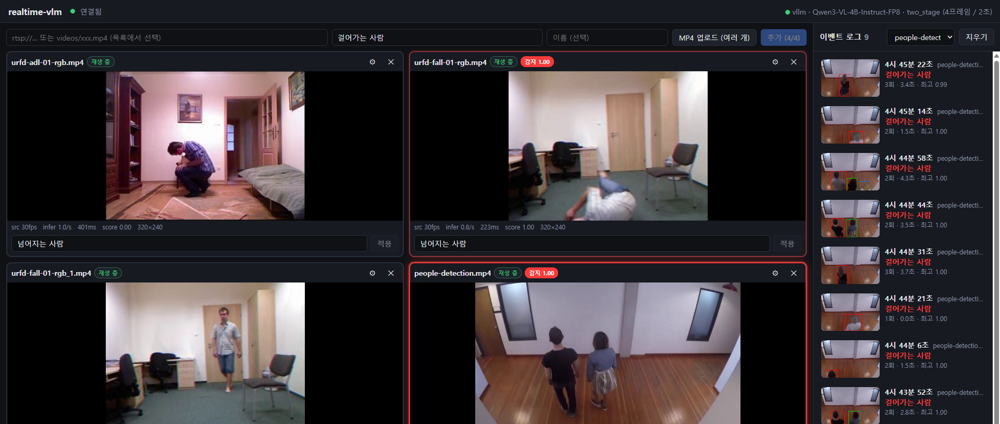

# realtime-vlm

**자유 텍스트 프롬프트로 다중 CCTV 영상에서 상황을 찾아내는 실시간 VLM 관제 시스템**

<div class="meta" markdown="1">

| | |
|---|---|
| **기간** | 2026.11 (개인 프로젝트, 설계·구현·평가 전담) |
| **한 줄 요약** | RTSP 카메라 / MP4 영상 최대 4개를 동시에 받아, `넘어지는 사람` 같은 자연어 질의에 해당하는 장면을 VLM으로 판단하고 위치(bbox)를 실시간으로 표시·기록 |
| **모델 / 서빙** | Qwen3-VL-4B-Instruct-FP8, vLLM (OpenAI 호환 API) |
| **기술 스택** | Python, FastAPI, OpenCV/FFmpeg, WebSocket, React 19 + TypeScript + Vite, Docker Compose, NVIDIA Container Toolkit |
| **하드웨어** | 소비자용 GPU 1장 (RTX 4060 8GB), WSL2 |

</div>

<div class="kpi">
<div><b>F1 0.92</b><span>낙상 검출 (오탐 0건)<br>초기 방식 대비 0.29 → 0.92</span></div>
<div><b>~0.2초</b><span>알람 지연 (프레임 → 경보)<br>개선 전 약 1.2초</span></div>
<div><b>4 스트림</b><span>8GB GPU 1장에서<br>동시 처리</span></div>
<div><b>IoU 0.99</b><span>bbox 위치 정확도<br>(pseudo-GT 대비)</span></div>
</div>



<p class="caption">2x2 스트림 그리드 + 우측 이벤트 로그. 프롬프트에 해당하는 대상이 검출되면 타일 테두리가 붉게 바뀌고 점수 배지와 bbox가 표시된다.</p>

## 1. 문제 정의

기존 CCTV 분석은 "사람", "차량"처럼 **미리 학습된 클래스**만 찾거나, 낙상·배회 같은 **상황마다 별도 모델**을 학습해야 한다. 이 프로젝트는 운영자가 찾고 싶은 상황을 **문장으로 입력하면** 바로 감시를 시작하는 시스템을 목표로 했다.

- **Open-vocabulary**: 한국어/영어 자유 텍스트 (`넘어지는 사람`, `a person walking` 등). 실행 중 프롬프트를 바꾸면 즉시 반영
- **시간 정보 활용**: "넘어지는" 같은 동작은 한 장의 이미지로 판단하기 어렵다 → 최근 2초의 프레임 여러 장을 함께 본다
- **제약 조건**: 클라우드 없이 **8GB 소비자 GPU 1장**, 모델은 **4B 이하**, 외부 접속 없는 로컬 환경

## 2. 시스템 아키텍처

```
 Browser ── :8000 ──▶ frontend (React + Vite)      2x2 그리드 · bbox 오버레이 · 이벤트 패널
                          │ /api, /ws, /event-files 프록시
                          ▼
                      backend (FastAPI)  ◀──────── RTSP 카메라 / MP4
                          │  스트림별 decode 스레드 → 링버퍼(10fps, 최근 4초)
                          │  스트림별 inference worker → 프레임 샘플링 → 2단계 추론
                          │  EventStore (쿨다운 병합 · 스냅샷 · jsonl)
                          │  REST / WebSocket / MJPEG
                          │ HTTP (OpenAI 호환)
                          ▼
                      serving (vLLM, GPU)  Qwen3-VL-4B-Instruct-FP8
                          continuous batching으로 4 스트림 요청을 묶어 처리
```

- **3-컨테이너 구성** (serving / backend / frontend, Docker Compose). backend는 서빙 서버와 URL로만 통신하므로 서빙을 다른 머신이나 다른 엔진(Triton)으로 교체해도 코드 변경이 없다.
- **설정 단일화**: `configs/config.yaml` 하나를 serving과 backend가 공유한다. `gen_env.py`가 이 값을 vLLM 실행 인자로 변환해, 전처리 해상도와 서버 측 메모리 프로파일링 크기가 어긋나는 일을 구조적으로 막았다.
- **개발 생산성**: 소스는 이미지에 넣지 않고 볼륨 마운트. backend는 uvicorn auto-reload, frontend는 HMR로 **코드 수정 시 재빌드 없음** (35GB 서빙 이미지를 다시 빌드하지 않아도 됨).

## 3. 핵심 기술 과제와 해결

### 3-1. 시간 정보와 위치 정확도를 동시에 얻기: 2단계(two_stage) 추론 설계

**문제** 처음에는 최근 프레임 4장을 한 번에 넣고 "마지막 프레임 기준 bbox를 JSON으로 출력하라"고 요청했다(multi_image). 그 결과 **좌표가 깨지고**(IoU 0.12), 9개 숫자로 된 비정상 박스가 나오는 등 F1이 0.29에 그쳤다. 반대로 프레임 1장으로 grounding만 하면 상황과 관계없이 **모든 사람**에게 박스를 쳐서 오탐이 40건 발생했다.

**해결** "상황 판단"과 "위치 찾기"를 분리했다.

1. **Judge**: 최근 2초에서 균등 샘플링한 4장을 시간 순서로 넣고 yes/no만 묻는다. 출력 토큰은 1개이고, 첫 토큰의 **logprobs에서 P(yes)를 정규화해 0~1 점수**로 사용한다 → threshold 조정이 가능한 연속 점수 확보.
2. **Grounding**: 점수가 threshold(0.5) 이상일 때만, **마지막 프레임 1장**에 대해 Qwen 학습 형식의 프롬프트(`Locate every instance ... Report bbox coordinates in JSON format.`)로 bbox를 요청한다. 모델 학습 분포에 맞춘 문구로 바꾸자 깨진 출력이 사라졌다.

0~1000 정규화 좌표를 0~1로 바꾸는 파서는 모델별 출력 형식 차이와 깨진 JSON을 정규식으로 복구하도록 만들었다.

### 3-2. 감이 아닌 수치로 결정: 라벨 기반 평가 하네스

모델과 추론 방식을 정하기 위해 평가 스크립트(`eval_strategies.py`)를 먼저 만들었다. UR Fall Detection 데이터셋 영상 4개에 낙상 구간을 라벨링하고, **0.25초 간격의 모든 시점**에서 검출 여부·bbox IoU·지연을 측정했다.

| 모델 | 방식 | Precision | Recall | F1 | 오탐 | IoU |
|---|---|---|---|---|---|---|
| 2B | multi_image (4장 → bbox 한 번에) | 0.28 | 0.31 | 0.29 | 21 | 0.12 |
| 2B | single_frame | 0.39 | 1.00 | 0.57 | 40 | 0.98 |
| 2B | two_stage, 4장 | 0.60 | 0.96 | 0.74 | 17 | 0.98 |
| 4B-FP8 | two_stage, 1장 | 0.92 | 0.85 | 0.88 | 2 | 0.98 |
| **4B-FP8** | **two_stage, 4장 (채택)** | **1.00** | **0.85** | **0.92** | **0** | **0.99** |

- **2B는 쪼그려 앉기를 넘어짐으로 판단**(점수 0.4~0.9)해 threshold를 0.9 근처로 아슬아슬하게 잡아야 했다. **4B-FP8은 음성 점수 최대 0.04, 양성 대부분 0.9 이상**으로 판단 여유(margin)가 커서 기본 모델로 채택했다.
- 같은 4B에서도 **4장이 1장보다 오탐이 적다(2 → 0)**: 시간 정보가 실제로 효과가 있음을 수치로 확인했다.
- 놓친 4건은 모두 넘어지기 시작하는 첫 0.25~0.5초로, 오검출이 아니라 **감지 지연**이라는 것을 분석으로 구분했다.

### 3-3. 8GB GPU에 4B 모델과 4개 스트림 올리기

Windows가 유휴 상태에서 약 1GB를 쓰므로 실제 가용 VRAM은 약 7GB였다. 4B 가중치만 5.85GB라 여유가 거의 없었다.

- **FP8 양자화 모델**로 가중치 크기를 줄이고, 입력 프레임의 긴 변을 **448px**로 축소(프레임당 비전 토큰 약 112개).
- vLLM은 기동 시 최대 크기 이미지로 비전 인코더 메모리를 프로파일링한다. 이 크기를 448px로 제한하고, HF 이미지 프로세서에도 **같은 픽셀 상한**을 걸어 큰 이미지가 들어와도 프로파일링 예산을 넘지 않게 했다. 덕분에 KV cache 약 3,200토큰을 확보(4장 요청 1건 ≈ 0.5k 토큰).
- `max_model_len 2048`, `max_num_seqs 4`, `gpu_memory_utilization 0.85`를 측정을 통해 조정했다.

### 3-4. 알람 지연 단축과 병목 분석

**Judge-first 알림**: judge 결과가 나오자마자 bbox를 기다리지 않고 WebSocket으로 먼저 보낸다. 경보 지연이 **약 1.2초 → 약 0.16초**로 줄었고, 박스는 약 1초 뒤에 따라온다. 화면 갱신과 이벤트 판단도 judge 결과를 기준으로 해서, grounding이 박스를 못 찾아도 경보는 유지된다.

**병목 분석**: 4스트림 동시 처리 시 요청 간격별로 지연을 측정했다.

| 스트림별 요청 간격 | Judge (p50) | 검출 시 Judge+bbox (p90) |
|---|---|---|
| 250 ms | 약 300 ms | 약 4 초 |
| 500 ms | 약 300 ms | 2.5~4 초 |
| **1000 ms (채택)** | 200~300 ms | **약 1.7 초** |

- 병목은 bbox 출력(약 44토큰)의 **decode 단계**였다. vLLM continuous batching에서 각 decode step이 다른 스트림 judge 요청의 prefill과 같은 step에 묶이면서 느려진다(단독 실행 시 약 1초).
- vLLM **priority scheduling**(bbox 요청 우선)을 적용했지만 측정상 효과가 없었다. 원인이 "순서"가 아니라 "같은 step 안에서의 혼합"이기 때문이라고 분석했고, 다음 개선 방향을 **출력 토큰 축소(structured output, 44 → 약 20토큰)**로 정했다.
- 스트림마다 **이전 요청이 끝나야 다음 요청**을 보내는 구조로, 처리량이 부족해도 큐가 쌓이지 않고 항상 최신 프레임을 분석한다(backpressure).

### 3-5. 스트림 입력과 이벤트 처리

- **입력 소스**: RTSP는 TCP transport + 지수 백오프 재연결(최대 10초), MP4는 원본 FPS로 반복 재생해 실제 카메라처럼 동작. 스트림마다 decode 스레드가 최신 원본 프레임과 **10fps 링버퍼(최근 4초)**를 유지하고, worker는 여기서 시간 윈도우 단위로 프레임을 샘플링한다.
- **이벤트 로그**: 같은 스트림에서 5초 이내 재검출은 하나의 이벤트로 병합(`count`, `last_seen` 갱신)해 알람 폭주를 막았다. 스냅샷은 **실제로 분석한 프레임**에 bbox를 그려 저장하므로, 화면상 박스가 움직이는 대상보다 약 1초 뒤처지는 것과 달리 기록은 정확하다. 메타데이터는 append-only jsonl로 저장한다.
- **테스트 인프라**: mediamtx + ffmpeg로 MP4를 RTSP 카메라처럼 송출하는 시뮬레이터, WebSocket 지연·검출률 모니터, 이미지/영상/구간 sweep 추론 CLI를 만들어 각 단계를 독립적으로 검증했다. UI는 Playwright로 "스트림 추가 → 2.9초 내 경보+박스 → 상세 모달" 흐름을 자동 확인했다.

### 3-6. 웹 UI

React 19 + TypeScript. 2x2 그리드에 MJPEG 영상과 % 좌표 기반 bbox 오버레이, 검출 상태 배지, 타일별 프롬프트/파라미터(프레임 수, 윈도우, 간격, threshold) 실시간 변경, 다중 MP4 업로드 시 빈 슬롯에 자동 배치, 이벤트 패널(스트림 필터, 스냅샷 상세)을 구현했다. 업로드 파일명 충돌 시 덮어쓰지 않고 `name_N`으로 저장한다.

## 4. 개발 과정

단계(Phase)별로 완료 기준을 정하고, 단계마다 측정 결과를 계획 문서에 기록한 뒤 커밋했다.

| 단계 | 내용 | 결과 |
|---|---|---|
| P0 | Docker + vLLM 서빙, 8GB 메모리 예산 확보 | 2B 모델 서빙 기동 |
| P1 | 추론 방식 3종 × 모델 2종 정량 평가 | 4B-FP8 + two_stage 채택 (F1 0.92) |
| P2 | 스트림 소스·worker·REST/WS/MJPEG API, 4스트림 부하 측정 | 기본 요청 간격 1000ms 결정 |
| P3–P4 | 이벤트 로그, judge-first 알림, React UI | 경보 지연 약 0.16초 |
| 구조 개편 | 단일 컨테이너 → serving/backend/frontend 3개 | 코드 수정 시 재빌드 불필요 |
| P5 (예정) | bbox 출력 토큰 축소, 4스트림 부하 안정화 | |
| P6 (예정) | Triton(vLLM backend) 서빙과 비교 | 서빙 계층 교체 가능 구조 검증 |

설계 결정과 측정값은 `PLAN.md`에, 실행·운영 방법은 `README.md`(영문/국문)에 정리했다.

## 5. 한계와 개선 방향

- **평가 표본이 작다**: 영상 4개 기준이다. 실제 CCTV 환경(야간, 원거리, 다수 인물)에서 재검증이 필요하다.
- **감지 지연**: 넘어지기 시작한 후 0.25~0.5초 뒤에 검출된다. 윈도우 길이와 샘플링 간격 튜닝으로 줄일 여지가 있다.
- **처리량**: GPU 사용률 100%에서 동작한다. 출력 토큰 축소, 스트림 수에 따른 요청 간격 자동 조절, Triton 비교를 계획하고 있다.

## 6. 배운 점

- **VLM은 "한 번에 다 시키는" 것보다 역할을 나눌 때 강하다.** 판단(분류)과 위치 찾기(grounding)를 분리하고, 각 단계를 모델이 학습한 형식에 맞추는 것이 프롬프트 문구를 다듬는 것보다 효과가 컸다.
- **logprobs로 생성 모델을 점수 모델로 쓸 수 있다.** yes/no 확률을 점수로 쓰면 threshold와 precision/recall 트레이드오프를 일반 분류기처럼 다룰 수 있다.
- **최적화 전에 병목을 측정한다.** priority scheduling은 그럴듯했지만 효과가 없었고, 원인을 batching 구조에서 찾으면서 실제 개선 방향(출력 토큰 수)을 정할 수 있었다.
- **제약이 설계를 만든다.** 8GB VRAM이라는 제약 때문에 해상도·프로파일링·KV cache 예산을 하나의 설정으로 묶는 구조가 나왔고, 이는 설정 실수를 막는 장치가 되었다.
